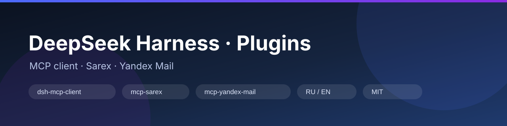
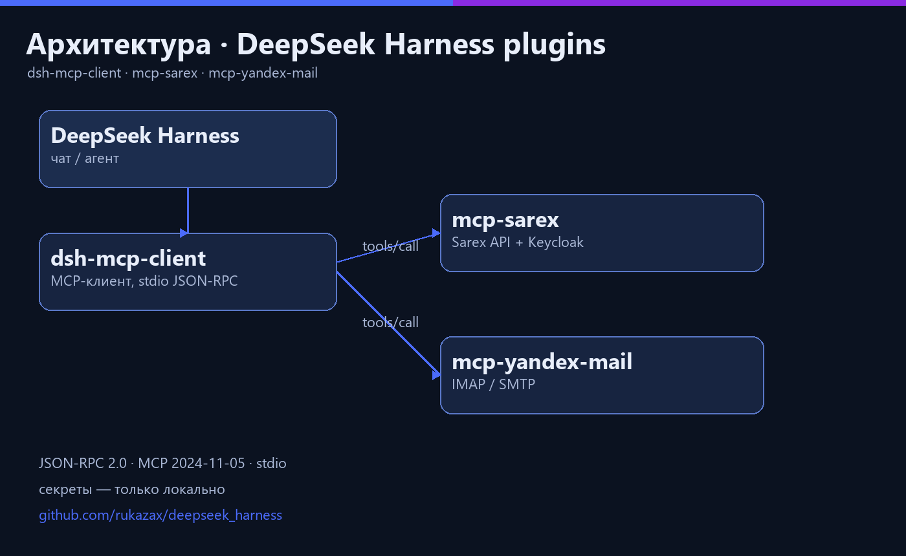
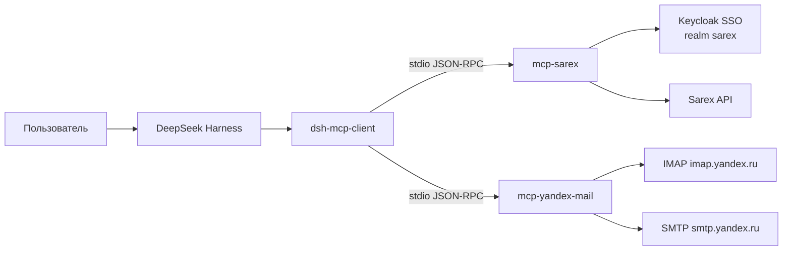
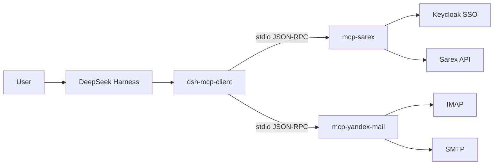

# DeepSeek Harness · Plugins

<p align="center">
  
</p>

<p align="center">
  
  
  
  
  
</p>

**RU** · [English](#english)

---

## О проекте

Репозиторий плагинов и MCP-серверов для **DeepSeek Harness (DSH)**. Каждый пакет оформлен по правилам DSH:
`package.json` с секцией `dsh.bundle`, `cordis.patch.yml`, документация, тестовый стенд, лицензия.

Комплект решает прикладную задачу: подключить к DSH внешние системы (Sarex, Яндекс.Почта) через
MCP-протокол и дать агентам единый, предсказуемый доступ к ним — без ручных скриптов на каждый случай.

## Состав

| Пакет | Назначение | Стек |
|---|---|---|
| [`dsh-mcp-client`](packages/dsh-mcp-client) | MCP-клиент для DSH: запускает MCP-серверы и регистрирует их инструменты как родные инструменты DSH | Node.js (ESM) |
| [`mcp-sarex`](packages/mcp-sarex) | MCP-сервер Sarex: Keycloak-авторизация, уведомления, произвольные запросы к API, интерактивный вход с 2FA | Python 3.12 |
| [`mcp-yandex-mail`](packages/mcp-yandex-mail) | MCP-сервер Яндекс.Почты: статус, папки, быстрый поиск по заголовкам, чтение, вложения, отправка | Python 3.12 |
| [`dsh-mobile`](packages/dsh-mobile) | Удалённое управление DSH с телефона (Android/раскладной): LAN-шлюз, pairing, SSE, PWA и in-process мост к сессиям; просмотр не тратит токены | Node.js + PWA |
| [`mcp-cua`](packages/mcp-cua) | Computer use для Windows: окна, UIA-дерево, скриншоты, клики и ввод через Cua Driver 0.28.0 | Node.js (ESM) |
| [`mcp-kot`](packages/mcp-kot) | Мост к агенту Kot в OpenClaw: один ход агента плюс состояние Gateway, каналов, агентов и сессий | Node.js (ESM) |

## Архитектура

<p align="center">
  
</p>



## Быстрый старт

### 1. Плагин MCP-клиента

```bash
# 1) скопировать пакет в профиль DSH
cp -r packages/dsh-mcp-client ~/.dsh/profiles/desktop/node_modules/dsh-mcp-client

# 2) добавить в профиль: package.json → dsh.profile.bundles, затем перезапустить DSH
```

В DSH появятся инструменты с префиксами `sarex__*` и `mail__*`.

### 2. MCP-серверы (отдельно от DSH)

```bash
python packages/mcp-sarex/server.py            # Sarex MCP (stdio)
python packages/mcp-yandex-mail/server.py      # Яндекс.Почта MCP (stdio)
```

Подключение в MCP-клиентах — см. [README пакета](packages/dsh-mcp-client/README.md).

## Схемы и документация

- [Архитектура и схемы](docs/ru/architecture.md) · [Architecture (EN)](docs/en/architecture.md)
- [Правила разработки и публикации](CONTRIBUTING.md) — двуязычные
- [Глобальное правило публикации](docs/ru/global-rule.md) · [Global rule (EN)](docs/en/global-rule.md)
- [mcp-cua: управление рабочим столом](docs/ru/mcp-cua.md) · [mcp-kot: мост к OpenClaw](docs/ru/mcp-kot.md)
- [Безопасность и секреты](docs/ru/security.md) · [Security (EN)](docs/en/security.md)

## Правила

1. Плагины разрабатываются по контракту DSH: `package.json` → `dsh.bundle.patch`, `cordis.patch.yml`, README.
2. Каждый пакет автономен: не тянет зависимости хоста без необходимости, не хранит секреты в коде.
3. Все новые плагины публикуются в этот репозиторий **автоматически** — без отдельного запроса и подтверждения.
4. Документация — двуязычная (RU/EN), в стиле GitHub: заголовки, таблицы, схемы, примеры команд.
5. Секреты — только в защищённом хранилище (`_secrets`), не в репозитории.

## Безопасность

- Учётные данные читаются из локального защищённого файла, который **не коммитится**.
- Записывающие операции MCP-инструментов требуют явного `confirm=true`.
- 2FA Sarex: API-токен выдаётся Keycloak без push-подтверждения; интерактивный вход — с подтверждением на телефоне.

## Лицензия

[MIT](LICENSE) © 2026 rukazax

---

## English

Repository of **DeepSeek Harness (DSH)** plugins and MCP servers. Every package follows DSH conventions:
`package.json` with `dsh.bundle`, `cordis.patch.yml`, documentation, test harness, license.

The kit connects DSH to external systems (Sarex, Yandex Mail) through MCP and gives agents a single,
predictable access path — no ad-hoc scripts per task.

| Package | Purpose | Stack |
|---|---|---|
| [`dsh-mcp-client`](packages/dsh-mcp-client) | MCP client for DSH: spawns MCP servers and registers their tools as native DSH tools | Node.js (ESM) |
| [`mcp-sarex`](packages/mcp-sarex) | Sarex MCP server: Keycloak auth, notifications, generic API requests, interactive 2FA login | Python 3.12 |
| [`mcp-yandex-mail`](packages/mcp-yandex-mail) | Yandex Mail MCP server: status, folders, fast header search, read, attachments, send | Python 3.12 |
| [`dsh-mobile`](packages/dsh-mobile) | Remote control of DSH from a phone (Android/foldable): LAN gateway, pairing, SSE, PWA and an in-process session bridge; viewing costs no tokens | Node.js + PWA |
| [`mcp-cua`](packages/mcp-cua) | Computer use for Windows: windows, UIA tree, screenshots, clicks and typing through Cua Driver 0.28.0 | Node.js (ESM) |
| [`mcp-kot`](packages/mcp-kot) | Bridge to the Kot agent in OpenClaw: one agent turn plus Gateway, channel, agent and session state | Node.js (ESM) |



### Quick start

```bash
cp -r packages/dsh-mcp-client ~/.dsh/profiles/desktop/node_modules/dsh-mcp-client
# add "dsh-mcp-client" to dsh.profile.bundles in package.json, restart DSH
python packages/mcp-sarex/server.py
python packages/mcp-yandex-mail/server.py
```

### Rules

1. Plugins follow the DSH contract (`dsh.bundle.patch`, `cordis.patch.yml`, README).
2. Every package is self-contained and keeps secrets out of code.
3. New plugins are published to this repository **automatically**, without a separate request or confirmation.
4. Documentation is bilingual (RU/EN) in GitHub style: headings, tables, diagrams, command examples.
5. Secrets live only in the local protected store (`_secrets`), never in the repository.

### Security

- Credentials are read from a local protected file that is **never committed**.
- MCP write operations require explicit `confirm=true`.
- Sarex 2FA: the API token is issued by Keycloak without a push prompt; interactive login requires phone approval.

### License

[MIT](LICENSE) © 2026 rukazax
