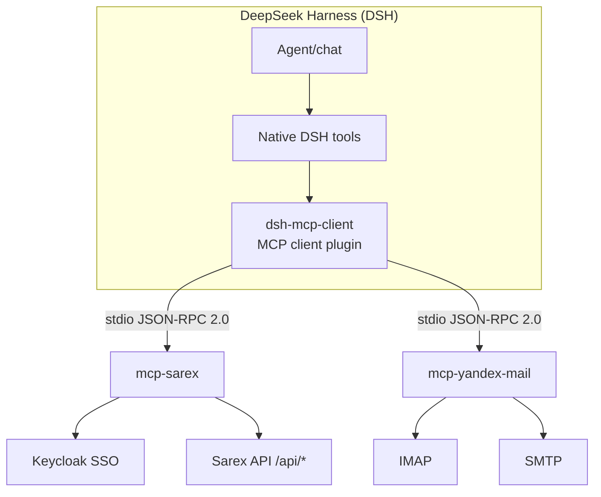

# Architecture (EN)

See [RU version](../ru/architecture.md) for the full bilingual document. Summary:

| Component | Responsibility |
|---|---|
| `dsh-mcp-client` | MCP process lifecycle, JSON-RPC, tool registration, timeouts, cleanup |
| `mcp-sarex` | Keycloak auth, Sarex API calls, interactive 2FA SSO, session storage |
| `mcp-yandex-mail` | IMAP sessions, header search, body/attachment extraction, SMTP send |

Principles: stdio-only transport; no external business logic in the plugin; secrets stay local;
one failing server does not block other tools.
