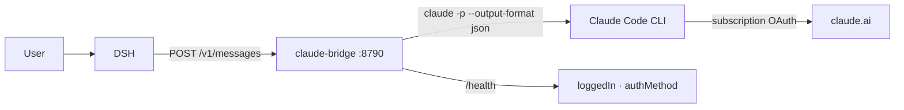

# claude-bridge — a Claude subscription inside DSH

The bridge exposes a loopback **Anthropic Messages** endpoint and executes requests
through the local **Claude Code CLI**, which is authorised by a Claude Pro/Max
subscription. DSH talks to it as an ordinary `anthropic-messages` provider.

## Why

A subscription is a CLI OAuth grant, not an API key; DSH accepts either a key or a custom
Anthropic-compatible endpoint. The bridge turns the subscription into exactly that endpoint.

## How it works



## Install and verify

```powershell
npm install -g @anthropic-ai/claude-code
claude auth login --claudeai
powershell -ExecutionPolicy Bypass -File .\install.ps1 -ProfilePatch
curl http://127.0.0.1:8790/health
```

Expected: `{"ok":true,"loggedIn":true,"authMethod":"claude.ai"}`.

## Protocol

| Route | Purpose |
|---|---|
| `POST /v1/messages` | plain response, or SSE when `stream: true` |
| `GET /v1/models` | model list for selectors |
| `GET /health` | CLI state |

SSE order: `message_start → content_block_start → ping → content_block_delta →
content_block_stop → message_delta → message_stop`.

## Limitations

- DSH tools are unavailable in such a chat: the CLI does not know harness tools. For a
  tool-using agent use OpenClaw with the `claude-cli` provider.
- DSH token counters read zero; usage is billed against the subscription limits.
- One CLI process per request: 2–10 s for a short answer.
- Images and tool calls are not forwarded.

## Operations

```powershell
Get-ScheduledTask -TaskName 'Claude Bridge' | Select TaskName,State
Stop-ScheduledTask  -TaskName 'Claude Bridge'
Start-ScheduledTask -TaskName 'Claude Bridge'
```

Rollback: `install.ps1 -Uninstall`, then remove the `claude-bridge` block from
`cordis.patch.yml` (the installer keeps a backup).
