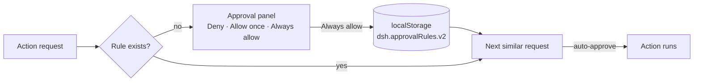

# dsh-approval-remember — an "Always allow" button for the approval panel

<p align="center">
  
</p>

A DSH client plugin that adds a third button to the “Waiting for approval” panel —
**“Always allow”**. The rule is stored locally and reused for requests that mean the
same thing, so the same kind of action stops asking for confirmation.

## How it works



The scenario key is derived from the approval title with normalisation: paths, URLs,
numbers, quotes and punctuation do not affect the match. A different kind of action
still asks.

## Install

```powershell
# DSH must be closed: client bundles are built at startup
& "<DSH>\resources\runtime\cli\bin\dsh.cmd" plugin --profile desktop add `
    "link:<path>\dsh-approval-remember"
```

## Managing rules

DevTools console (F12):

```js
window.__dshApprovalRemember.list()    // current rules
window.__dshApprovalRemember.clear()   // remove all
```

## Security

- Runs in the browser renderer only; nothing executes in the Host process.
- Rules live in `localStorage` and are never sent anywhere.
- Auto-approval matches the normalised scenario only.

## Limitations

- Rules belong to the DSH browser profile; clearing profile data removes them.
- Normalisation is heuristic: an overly generic title may merge unrelated actions.
