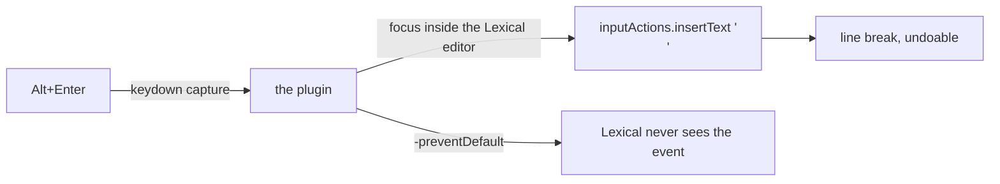

# dsh-composer-alt-enter — Alt+Enter in the chat composer

**RU** · [English](#english) · [Русский](../ru/dsh-composer-alt-enter.md)

## English

### What is being configured

The DSH composer: `Enter` submits, `Shift+Enter` inserts a built-in line break, `Ctrl/Cmd+Enter`
uses the complementary delivery mode. `Alt+Enter` is left to application shortcuts with no owner.
The plugin claims it: **Alt+Enter — line break**.

### How it works



- `keydown` capture phase on document; the target is `document.activeElement.closest('[data-lexical-editor]')`.
- The insertion uses the composer's official bridge: `captureInsertion()` + `insertText('\n', span)`;
  when the bridge is unavailable — `execCommand('insertLineBreak')` → `insertText`.
- `preventDefault()` + `stopImmediatePropagation()` — Lexical never receives the event, so there are
  no double breaks and no accidental sends.
- IME composition (`isComposing`) and key repeat are passed through.

### Install

```bash
# plugin_manager → install_bundle from packages/dsh-composer-alt-enter, restart DSH
```

### Caveats ⚠️

- The insertion works in the composer's plain mode; with a command menu (`/`) open, its key
  arbitration stays in charge — built-in logic the plugin does not intercept.
- Applies in every chat and in continuable-children composers.
- The host half is empty: `apply() {}`; everything lives in the `dsh.client` module.

Security: the plugin has no access to data or secrets; it only claims one key inside the composer editor.
