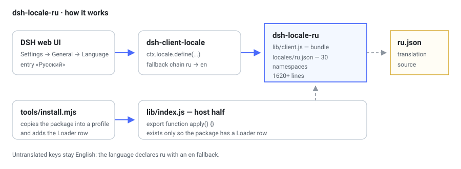
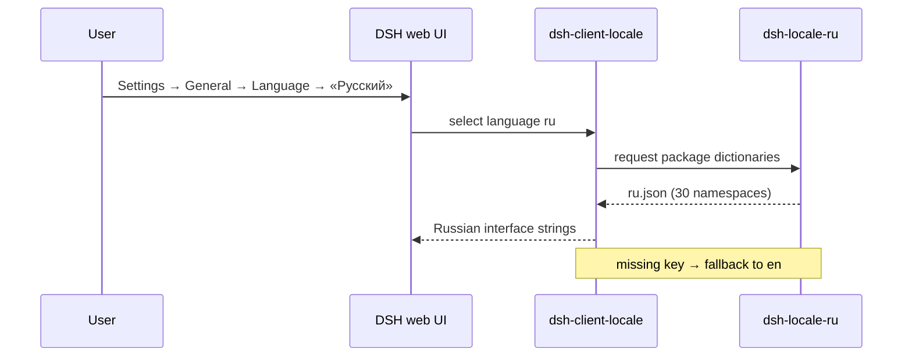

# dsh-locale-ru — Russian language pack for the DSH web UI

<p align="center">
  
</p>

[Русский](dsh-locale-ru.md) · **English**

Package page: [`packages/dsh-locale-ru`](../../packages/dsh-locale-ru) · Repository overview: [`README.md`](../../README.md) ·
Publishing rule: [`global-rule.md`](global-rule.md)

## Purpose

A DeepSeek Harness client plugin that adds a **«Русский»** entry under Settings → General → Language and
registers Russian dictionaries for every client package of the UI. It does not change DSH behaviour: it
only declares a language and dictionaries, so it can be enabled or disabled from settings without
restarting any service.

## What is inside

| Layer | File | Role |
|---|---|---|
| Manifest | `package.json` | `dsh.bundle.patch`, `dsh.client.inject`, exports `./client` |
| Mounting | `cordis.patch.yml` | a single Loader row |
| Host | `lib/index.js` | empty `apply()`, claims no services |
| Browser | `lib/client.js` | built bundle: language plus all dictionaries |
| Data | `locales/ru.json` | `package → key → Russian text`, 30 namespaces |
| Installer | `tools/install.mjs` | copies into a profile and adds the Loader row, with a backup |

Translation size: **1620+ lines** across **30 namespaces**, extracted from the dictionaries of the
installed DSH bundle (`app.asar`).

## How it works



## Install and remove

```bash
node tools/install.mjs --dry-run   # show the plan without changes
node tools/install.mjs             # install into the desktop profile
node tools/install.mjs --remove    # remove and restore the patch file
```

The script works offline, needs no pnpm and does not rebuild DSH. It backs up the profile
`cordis.patch.yml` before touching it.

## Verify

1. Open Settings → General → Language; the «Русский» entry is present.
2. Select it; the interface switches to Russian.
3. Strings missing from the dictionary stay English (the expected `ru → en` fallback).

## Limitations

- The translation matches the DSH build the dictionaries came from; newer builds may add keys that are
  absent here.
- Model output and tool names are not translated.
