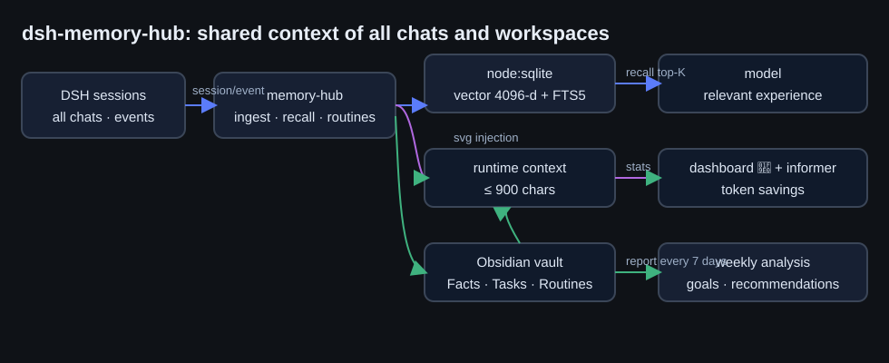
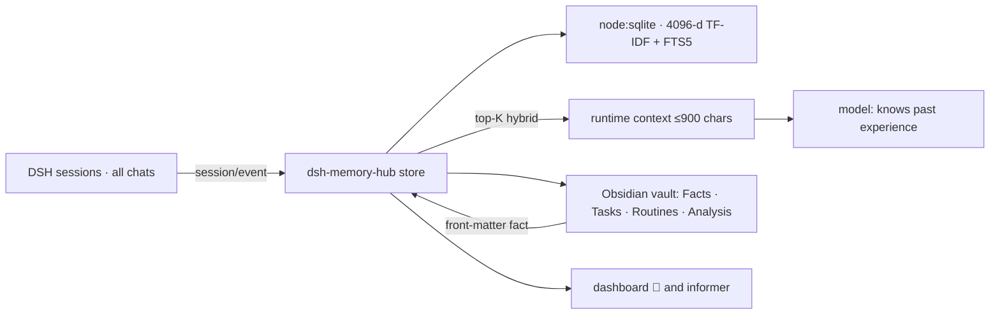

# dsh-memory-hub — shared context of all chats and workspaces

**RU** · [English](#english) · [Русский](../ru/dsh-memory-hub.md)

## English

### Why

DeepSeek Harness memory used to be bound to one session: past knowledge did not move between chats
and workspaces, solved tasks were recomputed, repeated requests were re-analysed from scratch. The
package closes that: one shared base next to the DSH profile, replenished automatically, with only
the relevant slice injected into context.

### How it works ⚙️

  

1. **Ingest.** Every turn of every session lands in SQLite: user requests (`chat_user`), final
   answers (`chat_assistant`), task+solution pairs (`task`), facts (`fact`) and vault notes
   (`doc`). Noise and service sources are filtered; the plugin's own injection is skipped.
2. **Recall.** Query → vector (hashed TF-IDF 4096-d, L2) → hybrid rank
   `0.68·cos + 0.32·coverage + workspace bonus + freshness` → top-3 lines ≤ 900 chars.
3. **Routines.** A normalized request template with 2+ occurrences becomes a routine carrying the
   last known solution; a similar new request gets the `<routine>` block before generic recall.
4. **Style.** Counters over the author's answers → `memory_style`; a small prompt section reminds
   the model to consult the profile before articles/posts.
5. **Analysis.** Every 7 days: dependency graph, bridges between workspaces, decisions vs results,
   goals and unfinished turns, recommendations → Obsidian `Аналитика/` + dashboard, `memory_analyze`.

### Setup, step by step

1. **Install** — `install_bundle` from `packages/dsh-memory-hub`, restart DSH.
2. **Vault.** `~/.dsh/obsidian/vault` is created automatically; open it in Obsidian if you like
   («Open vault» → select that folder). Your own notes need front-matter `memory-hub: fact`.
3. **Thresholds and budget** — config row `memory-hub`:

| Field | Default | Meaning |
|---|---|---|
| `recallChars` | `900` | injection size cap, chars |
| `recallLimit` | `3` | recall line limit |
| `minRecallScore` | `0.32` | recall hit threshold |
| `routineMinScore` | `0.45` | routine hit threshold |
| `autoMine` | `true` | routine mining over finalized turns |
| `weeklyAnalysis` | `true` | weekly analysis + vault report |
| `vaultSync` | `true` | vault write-back + note re-indexing |
| `dbPath` / `vaultPath` | `$DSH_HOME/…` | storage and vault paths |

### Verified ✅

- `memory_save` → `memory_search` returns the saved fact; the mirrored note appears in the vault.
- The `/api/memory-hub/stats|analysis|run-analysis|run-mining` endpoints answer JSON.
- Mining turns repeated phrasings into routines with `uses = N`.
- The `memory-hub:recall` block appears in the session runtime context.

### Caveats ⚠️

- Retrieval is lexical-vector: names, paths and numbers are caught tightly; synonyms match by a
  4-char word root. The e5-small upgrade path stays open: swap `embed(text, idf)`.
- Token budget: the recall block costs tokens only on a hit; an empty step adds nothing.
- The weekly analysis is heuristic (co-occurrence graph, unfinished turns); the deep read is the
  agent's layer over `memory_analyze`, which returns the full markdown.

Security and data placement: [Security](security.md).
