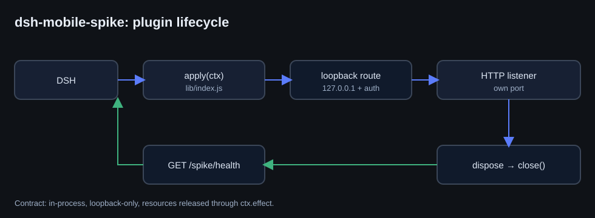
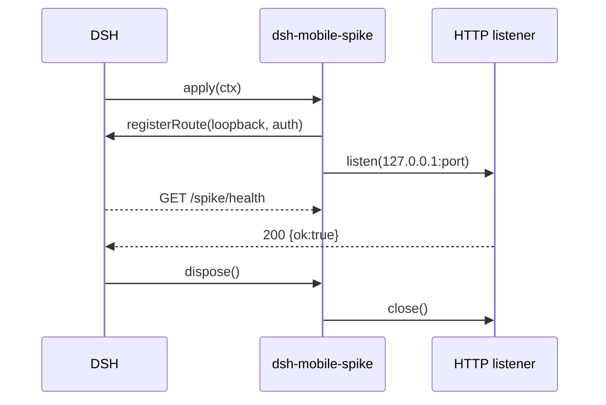

# dsh-mobile-spike — a minimal DSH plugin spike

<p align="center">
  
</p>

An experimental prototype that shows how an **in-process DSH plugin** is built: the
Cordis entry point, an authenticated loopback route, its own HTTP listener, and clean
resource release on dispose. It validated the plugin contract and became the basis for
`dsh-mobile`.

> Prototype, not for production: published as a plugin-structure example.

## What it shows

| Element | Meaning |
|---|---|
| `lib/index.js` | entry with `name`, `inject`, `apply(ctx)` |
| `cordis.patch.yml` | a valid `insert` with `id`, `name`, `config` |
| loopback route | reachable only from `127.0.0.1`, header-checked |
| `ctx.effect(() => dispose)` | listener released when the plugin unloads |

## Lifecycle



## Run

```powershell
& "<DSH>\resources\runtime\cli\bin\dsh.cmd" plugin --profile desktop add `
    "link:<path>\plugin-spike"
```

## Limitations

- Uses a free port; it is not pinned in config.
- No UI and no persistent state — the plugin contract only.
- See `dsh-mobile` for the production implementation.
