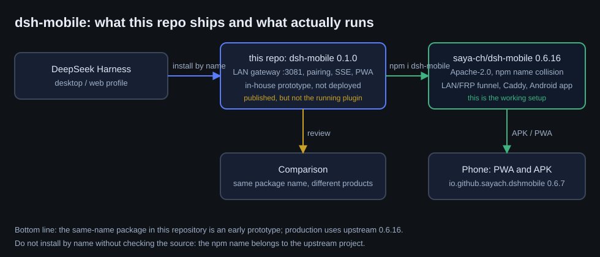
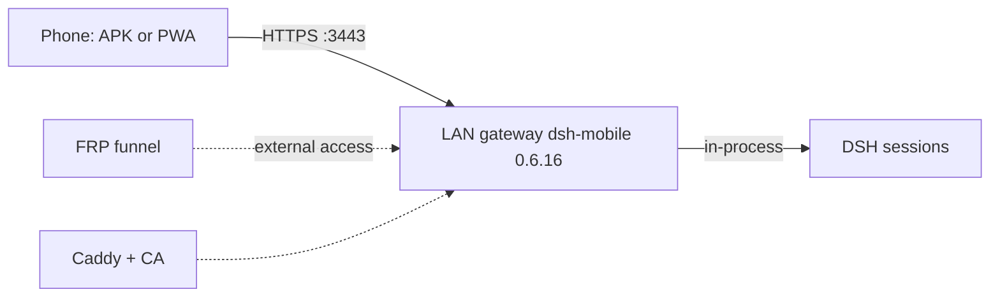

# dsh-mobile: what this repo ships and what actually runs

[Русский](../ru/dsh-mobile.md) · **EN**



## In short

This repository contains an **early prototype** `packages/dsh-mobile` version **0.1.0**: its own LAN gateway
on `:3081`, pairing codes, an SSE event stream of the session and a build-free PWA. It is published as a
package and remains a working architecture example, but **it is not deployed**.

Production uses **a different project with the same package name** — upstream
[`saya-ch/dsh-mobile`](https://github.com/saya-ch/dsh-mobile) version **0.6.16** (Apache-2.0): LAN/FRP funnel,
Caddy, the Android app `io.github.sayach.dshmobile` 0.6.7 and a web client. That is what is installed into the
DSH profile and configured on this stand (gateway `https://192.0.2.17:3443`, code pairing, TLS with a local CA).

| | This repository | Running setup |
|---|---|---|
| Package | `dsh-mobile` 0.1.0 (in-house) | `dsh-mobile` 0.6.16 (upstream, Apache-2.0) |
| Gateway | LAN `:3081`, HTTP/HTTPS | LAN `:3443` plus FRP funnel, Caddy |
| Client | build-free PWA | APK `io.github.sayach.dshmobile` plus PWA |
| Pairing | one-time codes, device tokens | codes and QR, device-side CA |
| State | prototype, not deployed | deployed and verified on a phone |

## Why it happened

1. The prototype was written to settle the contract: how to expose a live session to a phone without
   spending tokens (durable journal and the event bus only).
2. For production an upstream with a ready Android client and a funnel was chosen — no need to reinvent a
   mobile app and NAT traversal.
3. The package name collided: upstream publishes as `dsh-mobile`, so **do not install by name** —
   `npm i dsh-mobile` pulls upstream, not this prototype.

## Installing the prototype from this repository

```bash
# copy the directory instead of using a registry
git clone https://github.com/rukazax/deepseek_harness.git
cp -r deepseek_harness/packages/dsh-mobile ~/.dsh/profiles/desktop/node_modules/dsh-mobile
# then add the plugin id to the profile cordis.patch.yml and restart DSH
```

## How the upstream setup is configured



- the gateway listens on `3443`, the certificate is issued by a local CA and imported to the phone;
- pairing uses a one-time code; the device receives a token and is remembered;
- session browsing does not consume LLM tokens: the plugin reads the session journal and events without
  starting generation.

## Security

- pairing codes are one-time, with TTL and attempt limits; device tokens are stored hashed;
- the gateway is LAN-only by default; external access is a separate funnel and must be enabled deliberately;
- tokens, cookies and session content never enter the repository;
- the prototype (0.1.0) has no funnel and no Android client — that is a limitation, not "almost done".

## If you really need this prototype

1. Install by copying the directory (see above), not through a registry.
2. Check compatibility with your DSH version: the plugin contract changes, `cordis.patch.yml` may need edits.
3. Do not mix it with upstream in one profile: same package name, different `lib/`.
