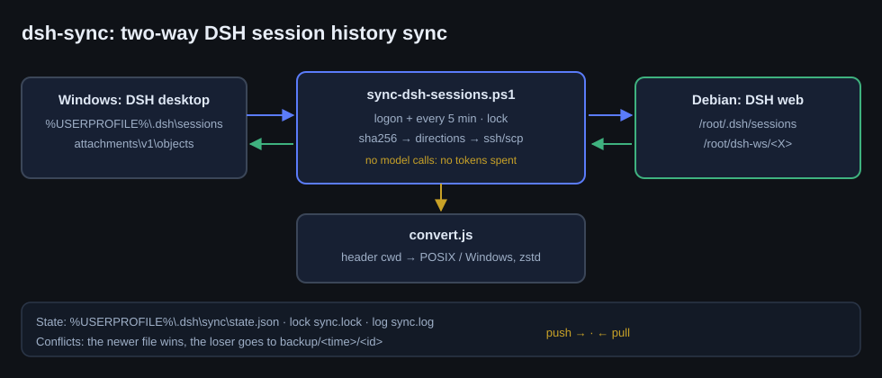
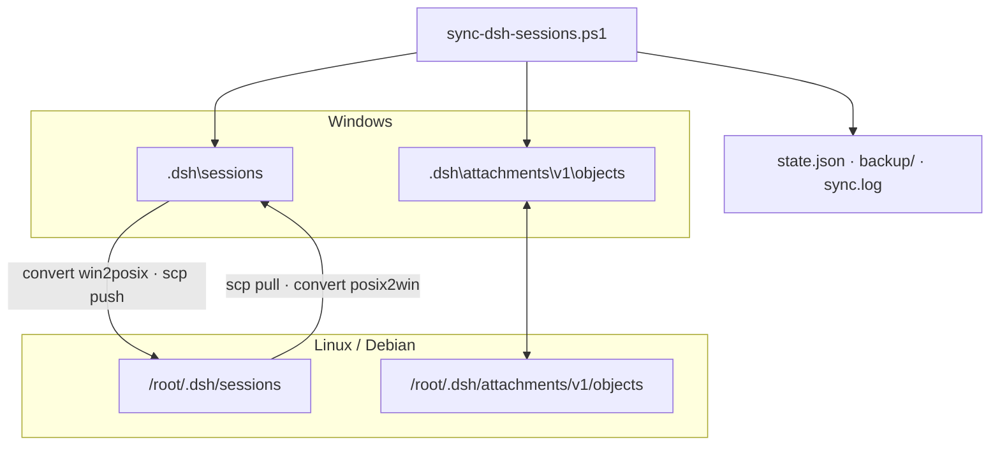

# dsh-sync: DeepSeek Harness session history sync

[Русский](../ru/dsh-sync.md) · **English** · [Package](../../packages/dsh-sync)

`dsh-sync` moves DeepSeek Harness session history between a Windows install and a remote Linux
instance: session logs, attachments and workspace folders. The sync makes no model calls — only files,
`ssh`/`scp` and zstd re-framing, so no tokens are spent.

## 1. The problem

DSH stores a session as a JSONL stream compressed with Zstandard. The first frame is the header line,
and its `cwd` must be an **absolute path for the current platform**:

- on Windows that is `C:\Users\<user>\Documents\deepseek-harness\<X>`;
- on Linux only paths starting with `/` are absolute.

Copying a log across platforms therefore produces a header the receiver rejects: `readHeader` fails with
`format v2 header cwd must be absolute`, and the session never shows up in the list. A transfer is
two steps: rewrite the header, then re-frame the archive.

## 2. What `convert.js` does

1. Reads the log and splits zstd frames: the first one holds the header, the rest carry events.
2. Parses the header JSON and replaces `cwd` through a prefix map (longest matching prefix wins).
3. Writes a new file: the first frame is exactly the rewritten header line, the following frames are the
   original events, unchanged.
4. Prints a JSON report: `id`, `from`, `to`, `target`, `events`, `bytes`, `sha256`, `changed`.

Events are never rewritten, so format v4 stays compatible in both directions; verified on 38 sessions —
the remote instance reads history, headers and token statistics.

Path map (defaults; the Windows home comes from `USERPROFILE`):

| Windows | Linux |
|---|---|
| `C:\Users\<user>\Documents\deepseek-harness\` | `/root/dsh-ws/` |
| `C:\Users\<user>\` | `/root/win-home/` |
| `C:\` | `/root/win-c/` |

When no prefix matches, the path is still made absolute for the target platform: `C:\X\Y` → `/root/win-c/X/Y`.

## 3. The orchestrator `sync-dsh-sessions.ps1`

One pass:

1. **Inventory.** Local logs are hashed; the remote side is inventoried through `remote-inventory.sh`
   (sizes plus sha256).
2. **Directions.** Each log is compared with `state.json`: changed locally only → push, remotely only →
   pull, nowhere → skip.
3. **Convert and transfer.** For push the log is converted `win2posix` and copied with `scp`; the remote
   side receives it with `remote-push.sh` (staging, then an atomic swap). Pull is symmetric, `posix2win`.
4. **Conflicts.** If a file changed on both sides, the newer one wins and the loser is copied into a
   timestamped backup.
5. **State.** Both sides' sha256 values go to `state.json`, a line goes to `sync.log`.

Flags: `-DryRun` (print the plan), `-ForceInitialPush` (initial upload without comparison), `-Quiet`
(no output). The `sync.lock` file prevents overlapping passes.

## 4. Install and schedule

```
%USERPROFILE%\.dsh\bin\dsh-sync\        sync-dsh-sessions.ps1, convert.js
/root/dsh-sync/                         remote-inventory.sh, remote-push.sh, incoming/
```

- PowerShell 5.1+, OpenSSH client, Node.js 22.15+ (Zstandard in `node:zlib`).
- SSH alias from `DSH_SYNC_SSH` (default `debian17-root`), key-based, `BatchMode=yes`.
- Task Scheduler task **“DSH Session Sync”**: at logon and every five minutes, hidden.

Checks:

```powershell
powershell -NoProfile -ExecutionPolicy Bypass -File sync-dsh-sessions.ps1 -DryRun
Get-ScheduledTaskInfo -TaskName 'DSH Session Sync' | Select LastRunTime,LastTaskResult
Get-Content "$env:USERPROFILE\.dsh\sync\sync.log" -Tail 20
```

## 5. Diagram





## 6. Limitations and troubleshooting

| Symptom | Cause | Fix |
|---|---|---|
| A session is missing on the other side | header not converted | run `-DryRun`, inspect the `convert.js` report |
| `node.exe not found` | no Node 22.15+ | install Node or put it in PATH |
| `Permission denied (publickey)` | no key-based access | check `ssh <alias> true` |
| A session was overwritten | both sides edited at once | restore from `backup/<time>` |
| Sync seems stuck | a stale `sync.lock` after a crash | delete `sync.lock`, run once manually |

Limitations: append-only logs are not merged on concurrent writes; deletions are not propagated; on a
remote machine without LLM keys sessions are read-only.

## 7. License

MIT — see the [package LICENSE](../../packages/dsh-sync/LICENSE).
