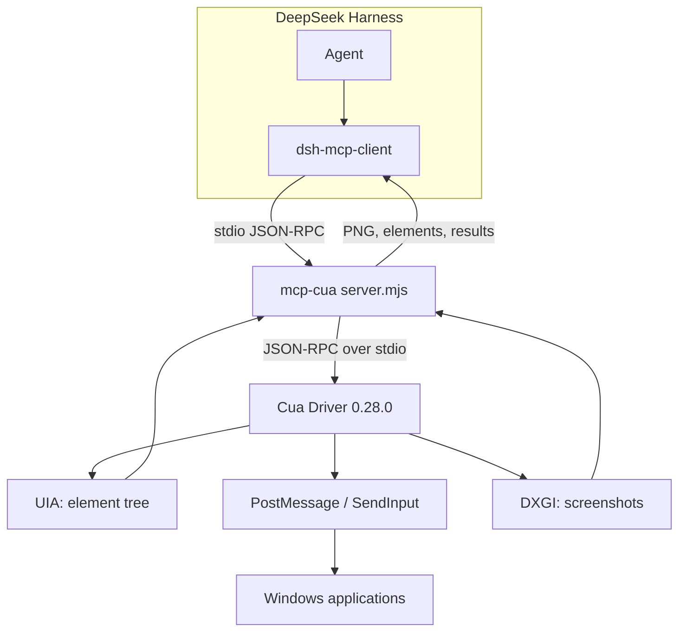

# mcp-cua — driving the Windows desktop from DSH

A stdio MCP server that gives a DeepSeek Harness agent native computer use on Windows through the Cua
driver 0.28.0.

## Purpose

DSH ships computer use on macOS only. On Windows this bridge fills the gap: the agent sees windows
and the accessibility tree, presses buttons, types, drags, reads the clipboard and takes screenshots —
locally, without a cloud service.

## How it works



The key decision is **a separate process**. The native driver runs outside DSH: if it crashes, the
agent session survives and `dsh-mcp-client` restarts the server.

## Tools

The curated set (26) is exposed by default; `--all` exposes all 56 driver tools.

| Group | Tools |
|---|---|
| Inspection | `list_apps`, `list_windows`, `get_window_state`, `get_accessibility_tree`, `get_desktop_state`, `get_screen_size`, `zoom` |
| Apps and windows | `launch_app`, `bring_to_front`, `set_window_frame`, `kill_app` |
| Actions | `click`, `double_click`, `right_click`, `drag`, `scroll`, `type_text`, `press_key`, `hotkey`, `set_value`, `invoke_menu` |
| Verification | `verify_state`, `check_permissions`, `health_report` |
| Clipboard | `clipboard_read`, `clipboard_write` |

Every tool accepts either `element_index`/`element_token` (preferred) or pixel coordinates in the
window screenshot space.

## Install

```bash
cd ~/.dsh/bin/cua-mcp
pnpm install            # @trycua/cua-driver 0.28.0
# register in the DSH profile: mcp.servers.pc → command: node, args: [server.mjs]
```

A ready profile fragment lives in this package's `cordis.patch.yml`.

## Input delivery

| Mode | Behaviour | When to use |
|---|---|---|
| `background` (default) | UIA Invoke and PostMessage, the window is never raised, focus is kept | almost always |
| `foreground` | brief activation plus SendInput, then the previous foreground is restored | only after `background_unavailable` |

Rule of thumb: try `background` first; the driver reports when background delivery is impossible.

## Verified

- Windows 11 x64, DSH 0.2.1-rc.2: tools appear as `mcp__pc__*`, window snapshots and clicks by
  `element_index` work, focus is not stolen;
- a driver failure does not take DSH down: the client restarts the server.

## Limits

- Windows only; macOS should use the built-in computer use, Linux needs another driver (untested).
- Chromium/Electron surfaces may require `foreground`: background PostMessage does not reach them.
- A minimised window cannot be captured or clicked until it is raised.
- Privacy: screenshots go to the model, so no secrets on screen while driving.
