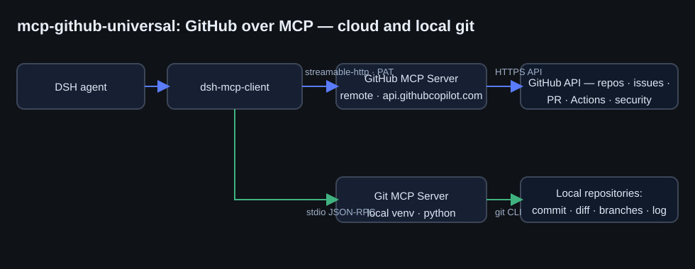

# mcp-github-universal — universal GitHub MCP

**RU** · [English](#english) · [Русский](../ru/mcp-github-universal.md)

## English

### Why

Working with GitHub from DeepSeek Harness used to be narrow: shelling out to `git` locally and nothing
for the cloud. The package settles it once and for all: one bundle, two MCP servers, the full GitHub API
toolset plus local git — no ad-hoc scripts per task.

### Components

| Part | Transport | Notes |
|---|---|---|
| Official remote GitHub MCP Server | `streamable-http` → `api.githubcopilot.com/mcp/x/all` | all toolsets: repos, issues, pull_requests, actions, code_security, discussions, users, gists and more |
| `mcp-server-git` (reference MCP server) | `stdio` from the `~/.dsh/venvs/mcp-git` venv | status, diff, commits, branches, merge and log in local repositories |

<p align="center">
  
</p>

### Setup, step by step

1. **Token** 🔑. `github.com/settings/personal-access-tokens/new` → a fine-grained PAT:
   `Contents`, `Issues`, `Pull requests` — Read and write, `Metadata` — read-only (automatic),
   `Actions` — Read; `Workflows` — Read and write for Actions files. Classic token: `repo` + `workflow` scopes.
2. **Environment variable.** Add `GITHUB_PERSONAL_ACCESS_TOKEN=github_pat_...`
   to `~/.dsh/.env` — variables are sampled at DSH startup, so restart DeepSeek Harness afterwards.
   The secret never reaches the repository.
3. **venv for the local Git server.**

   ```bash
   python -m venv ~/.dsh/venvs/mcp-git
   ~/.dsh/venvs/mcp-git/Scripts/python -m pip install mcp-server-git    # Windows
   #    Linux: ~/.dsh/venvs/mcp-git/bin/python
   ```

4. **Install the package into the DSH profile** — `packages/mcp-github-universal/cordis.patch.yml`
   via `install_bundle`. Tools appear in conversation: `mcp__github__get_me`,
   `mcp__github__create_issue`, `mcp__git__git_status`, and so on.

### Configuration (key fields)

| Field | Value | Meaning |
|---|---|---|
| `url` | `.../mcp/x/all` | all toolsets at once — narrow with the `X-MCP-Toolsets` header if needed |
| `headers.Authorization` | `Bearer <GITHUB_PERSONAL_ACCESS_TOKEN>` (via `!!js`) | token from the environment variable, not from a package file |
| `failOnStartupError` | `false` (GitHub) / `true` (git) | without a token DSH starts softly; the local server must always come up |
| `reconnect` | 0.5 s → 30 s, up to 10 attempts | after a drop GitHub reconnects itself |
| `toolCallTimeoutMs` | `120000` | long operations (code search, Actions logs) get enough time |

### Verified ✅

- Calling `mcp__github__get_me` returns the token owner's account — `rukazax`.
- The `mcp__git__*` tools register and answer for real repositories.
- Without a token the GitHub part does not disturb the work: DSH starts, the tools are simply absent.

### Token permissions — the pit we hit 🪤

A fine-grained PAT does not give repository write access by default: `permissions.push=true` in the
API is account-level, not token-level. Write access comes only from **Repository permissions →
Contents → Read and write** on the token card itself (and the token string stays the same).
A classic token with the `repo` scope sidesteps the whole subtlety.

### Rotation and revocation

Tokens page on GitHub → new token → update `GITHUB_PERSONAL_ACCESS_TOKEN` in `~/.dsh/.env` → restart DSH.

### Caveats ⚠️

- GitHub API rate limits apply, same as for the token.
- For private repositories the `all` toolsets are enough as long as the token covers them.
- On Linux mind the path: `venvs/mcp-git/bin/python` instead of `Scripts/` — the local copy of
  the patch knows about this (see `cordis.patch.yml`).

Token security and other common points: [Security](security.md).
