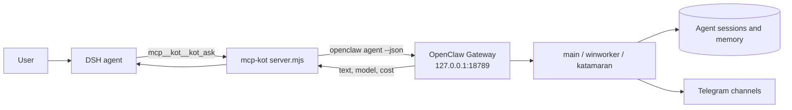

# mcp-kot — a bridge from DSH to the Kot agent (OpenClaw)

A stdio MCP server that gives a DeepSeek Harness agent a direct line to the Kot agent in OpenClaw:
send a prompt, get the answer verbatim, and inspect Gateway, channel, agent, session and workspace
state.

## Purpose

DSH and OpenClaw solve different problems. DSH is strong on files, commands and builds; Kot holds
long-running coordination, review and Telegram. The bridge removes the app switch: a DSH agent calls
Kot as a tool and gets its reply.

## How it works



The bridge is deliberately thin: it does not reimplement OpenClaw, it calls its CLI and parses the
JSON reply.

## Tools

| Tool | What it does |
|---|---|
| `kot_ask` | one agent turn: `prompt`, `workspace`, `session_key`, `agent`, `thinking`, `timeout_seconds`; returns text, model, cost |
| `kot_status` | Gateway version, pid, session count, agents, channel state, degraded plugins |
| `kot_channels` | Telegram accounts: running/connected, mode, errors |
| `kot_agents` | OpenClaw agents with working directories and models |
| `kot_sessions` | recent sessions and chats (agent, key, status, time) |
| `kot_workspaces` | DSH workspace map (path, name, chat count) |

## Sessions

One `session_key` is one continuous conversation. The default key derives from the workspace folder
name (`dsh-<name>`), so every project keeps its own line to Kot and its own history.

A practical consequence: a long task cannot fit into a single call. The working mode is a short
assignment, then a short status poll; the task lives in Kot's session between calls.

## Install

```bash
# requires a running OpenClaw Gateway and the openclaw CLI in PATH
# register in the DSH profile: mcp.servers.kot → command: node, args: [server.mjs]
```

A ready fragment lives in the package's `cordis.patch.yml`; the tools appear as `mcp__kot__*`.

## Verified

- OpenClaw Gateway 2026.10.5, DSH 0.2.1-rc.2: `kot_status` reports the version, agents and Telegram
  channel state; `kot_ask` returns the agent reply with model and cost;
- with the Gateway down the tools return a clear error instead of hanging.

## Limits

- Needs a running Gateway: the bridge is a link, not a replacement.
- Default timeout is 840 seconds per turn; very long tasks come back partially.
- The reply is text: attachments and files need separate tools.
- The bridge knows nothing beyond the `prompt` it is given.
