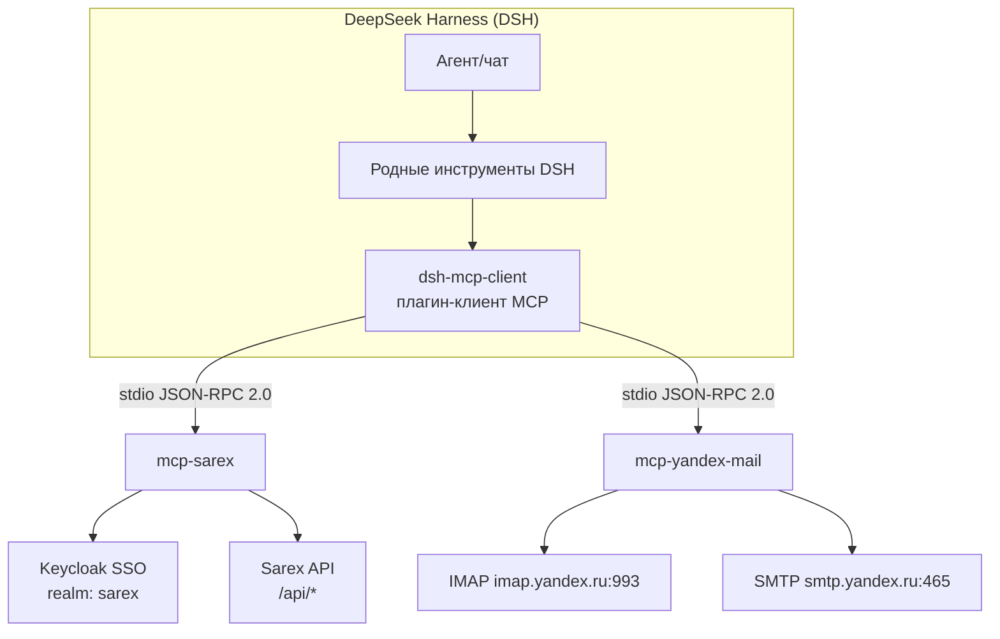
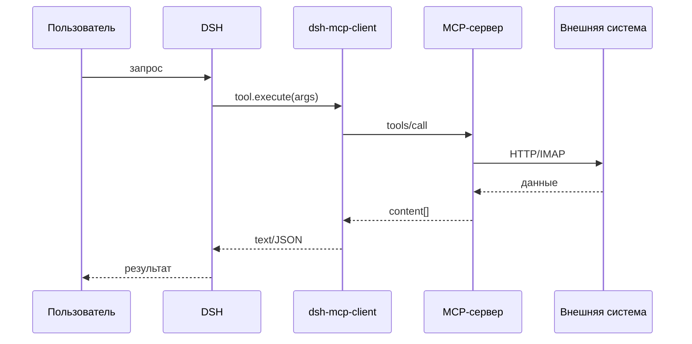
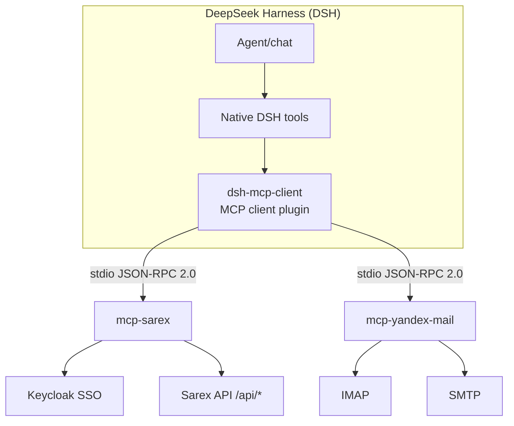
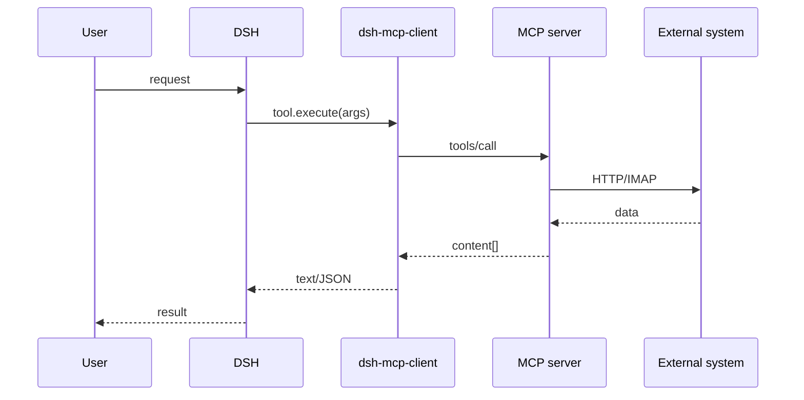

# Архитектура · Architecture

**RU** · [English](#english)

## RU

### 1. Слои системы

### 2. Поток вызова инструмента

### 3. Границы ответственности

| Компонент | Ответственность |
|---|---|
| `dsh-mcp-client` | жизненный цикл MCP-процессов, JSON-RPC, регистрация инструментов, таймауты, освобождение ресурсов |
| `mcp-sarex` | авторизация Keycloak, вызовы Sarex API, интерактивный SSO с 2FA, хранение сессии |
| `mcp-yandex-mail` | IMAP-сессии, поиск по заголовкам, извлечение тела/вложений, отправка через SMTP |

### 4. Принципы

1. Транспорт — stdio JSON-RPC 2.0 (MCP 2024-11-05): без сетевых портов и фоновых демонов.
2. Плагин не содержит бизнес-логики внешних систем — только транспорт и регистрацию инструментов.
3. Секреты не покидают локальное защищённое хранилище.
4. Ошибка одного MCP-сервера не блокирует остальные инструменты.

---

## English

### 1. Layers

### 2. Tool call flow

### 3. Responsibility boundaries

| Component | Responsibility |
|---|---|
| `dsh-mcp-client` | MCP process lifecycle, JSON-RPC, tool registration, timeouts, cleanup |
| `mcp-sarex` | Keycloak auth, Sarex API calls, interactive 2FA SSO, session storage |
| `mcp-yandex-mail` | IMAP sessions, header search, body/attachment extraction, SMTP send |

### 4. Principles

1. Transport is stdio JSON-RPC 2.0 (MCP 2024-11-05): no open ports, no background daemons.
2. The plugin holds no external-domain business logic — transport and registration only.
3. Secrets never leave the local protected store.
4. A failing MCP server does not block other tools.
