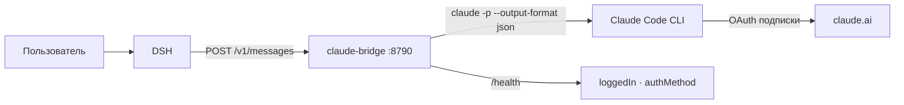

# claude-bridge — подписка Claude внутри DSH

Мост поднимает локальный эндпоинт в формате **Anthropic Messages** и выполняет запросы
через локальный **Claude Code CLI**, который авторизован подпиской Claude Pro/Max.
DSH подключается к мосту как к обычному провайдеру с протоколом `anthropic-messages`.

## Зачем

Подписка — это OAuth-грант CLI, а не API-ключ; DSH умеет либо ключ, либо произвольный
Anthropic-совместимый эндпоинт. Мост как раз и превращает подписку в такой эндпоинт.

## Схема



## Установка и проверка

```powershell
npm install -g @anthropic-ai/claude-code
claude auth login --claudeai
powershell -ExecutionPolicy Bypass -File .\install.ps1 -ProfilePatch
curl http://127.0.0.1:8790/health
```

Ожидаемый ответ: `{"ok":true,"loggedIn":true,"authMethod":"claude.ai"}`.

## Протокол

| Маршрут | Что делает |
|---|---|
| `POST /v1/messages` | обычный ответ или SSE при `stream: true` |
| `GET /v1/models` | список моделей для селектора |
| `GET /health` | состояние CLI |

SSE-последовательность: `message_start → content_block_start → ping → content_block_delta →
content_block_stop → message_delta → message_stop`.

## Ограничения

- Инструменты DSH в таком чате недоступны: CLI не знает инструментов харнесса.
  Агент с инструментами — OpenClaw, провайдер `claude-cli`.
- Счётчик токенов DSH показывает нули, расход — по лимитам подписки.
- Один запуск CLI на запрос: 2–10 секунд на короткий ответ.
- Изображения и tool-вызовы не передаются.

## Эксплуатация

```powershell
Get-ScheduledTask -TaskName 'Claude Bridge' | Select TaskName,State
Get-ScheduledTaskInfo -TaskName 'Claude Bridge' | Select LastRunTime,LastTaskResult
Stop-ScheduledTask  -TaskName 'Claude Bridge'
Start-ScheduledTask -TaskName 'Claude Bridge'
```

Откат: `install.ps1 -Uninstall` и удалить блок `claude-bridge` из `cordis.patch.yml`
(установщик делает резервную копию).
