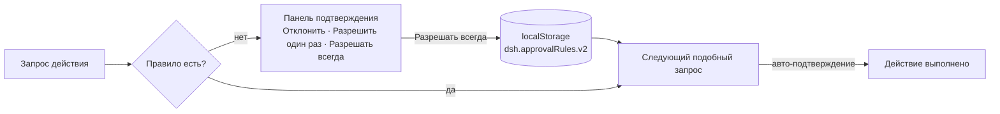

# dsh-approval-remember — «Разрешать всегда» в окне подтверждения

<p align="center">
  
</p>

Клиентский плагин DSH, который добавляет в панель «Ожидание подтверждения» третью
кнопку — **«Разрешать всегда»**. Правило запоминается локально и применяется к
одинаковым по смыслу запросам: тот же тип действия больше не спрашивает
подтверждения.

## Как работает



Сценарий определяется по заголовку подтверждения с нормализацией: пути, URL, числа,
кавычки и пунктуация на совпадение не влияют. Другой тип действия спрашивает как
обычно.

## Установка

```powershell
# DSH должен быть закрыт: клиентские бандлы собираются при старте
& "<DSH>\resources\runtime\cli\bin\dsh.cmd" plugin --profile desktop add `
    "link:<путь>\dsh-approval-remember"
```

## Управление правилами

В консоли DevTools (F12):

```js
window.__dshApprovalRemember.list()    // текущие правила
window.__dshApprovalRemember.clear()   // удалить все
```

## Безопасность

- Выполняется только в браузерном рендерере, в Host-процессе кода нет.
- Правила лежат в `localStorage`, никуда не отправляются.
- Автоподтверждение срабатывает лишь при совпадении нормализованного сценария.

## Ограничения

- Правила привязаны к профилю браузера DSH; очистка данных профиля их удаляет.
- Нормализация эвристическая: слишком общий заголовок может «склеить» разные действия.
