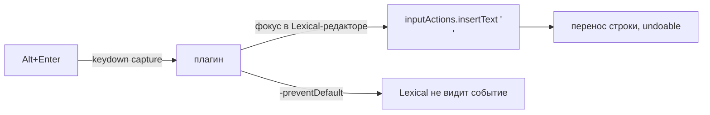

# dsh-composer-alt-enter — Alt+Enter в композере чата

**RU** · [English](../en/dsh-composer-alt-enter.md)

## RU

### Что настраивается

Композер DSH: `Enter` — отправка, `Shift+Enter` — встроенный перенос, `Ctrl/Cmd+Enter` —
дополнительный режим доставки. `Alt+Enter` оставлена application shortcuts без владельца.
Плагин занимает её: **Alt+Enter — перенос строки**.

### Как работает



- capture-фаза `keydown` на document: цель — `document.activeElement.closest('[data-lexical-editor]')`.
- Вставка — официальный мост композера: `captureInsertion()` + `insertText('\n', span)`;
  при недоступности — `execCommand('insertLineBreak')` → `insertText`.
- `preventDefault()` + `stopImmediatePropagation()` — Lexical не получает событие, поэтому двойных
  переносов и случайных отправок нет.
- IME-составление (`isComposing`) и long-press repeat пропускаются.

### Установка

```bash
# plugin_manager → install_bundle из packages/dsh-composer-alt-enter, перезапуск DSH
```

### Тонкости ⚠️

- Вставка работает в plain-режиме; при открытом меню команд (`/`) набор остаётся у меню — встроенная
  арбитражная логика композера, плагин её не перехватывает.
- Действует во всех чатах и композерах continuable-детей.
- Хостовая половина пустая: `apply() {}`, всё в клиентском модуле `dsh.client`.

Безопасность: плагин не имеет доступа ни к каким данным и секретам; он только перехватывает одну
клавишу в редакторе композера.
