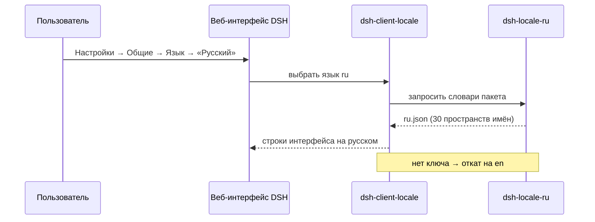

# dsh-locale-ru — русский язык для веб-интерфейса DSH

<p align="center">
  
</p>

**RU** · [English](dsh-locale-ru.en.md)

Страница пакета: [`packages/dsh-locale-ru`](../../packages/dsh-locale-ru) · Обзор репозитория: [`README.md`](../../README.md) ·
Правило публикации: [`global-rule.md`](global-rule.md)

## Назначение

Клиентский плагин DeepSeek Harness, который добавляет в «Настройки → Общие → Язык» пункт
**«Русский»** и регистрирует русские словари для всех клиентских пакетов интерфейса. Плагин не
меняет поведение DSH: он только объявляет язык и словари, поэтому включается и отключается из
настроек без перезапуска сервисов.

## Что внутри

| Слой | Файл | Роль |
|---|---|---|
| Манифест | `package.json` | `dsh.bundle.patch`, `dsh.client.inject`, экспорт `./client` |
| Монтирование | `cordis.patch.yml` | одна строка Loader |
| Хост | `lib/index.js` | пустой `apply()`, сервисов не занимает |
| Браузер | `lib/client.js` | собранный бандл: язык и все словари |
| Данные | `locales/ru.json` | `пакет → ключ → русский текст`, 30 пространств имён |
| Установка | `tools/install.mjs` | копирование в профиль и строка Loader, с резервной копией |

Объём перевода: **1620+ строк** в **30 пространствах имён**. Источник — словари, извлечённые из
установленного DSH (`app.asar`).

## Схема работы



## Установка и удаление

```bash
node tools/install.mjs --dry-run   # показать план без изменений
node tools/install.mjs             # установить в профиль desktop
node tools/install.mjs --remove    # удалить и вернуть patch-файл
```

Скрипт работает офлайн, не требует pnpm и не пересобирает DSH. Перед изменением
`cordis.patch.yml` профиля создаётся резервная копия.

## Проверка

1. Открыть «Настройки → Общие → Язык» — пункт «Русский» присутствует.
2. Выбрать его — интерфейс переключается на русский.
3. Строки, которых нет в словаре, остаются английскими (ожидаемый откат `ru → en`).

## Ограничения

- Перевод соответствует версии DSH, из которой извлечены словари; в новых сборках часть ключей может
  отсутствовать.
- Содержимое ответов модели и имена инструментов не переводятся.
