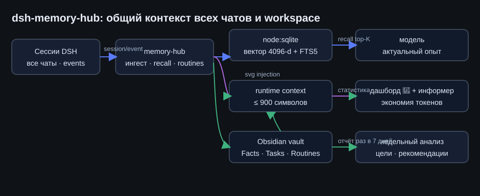
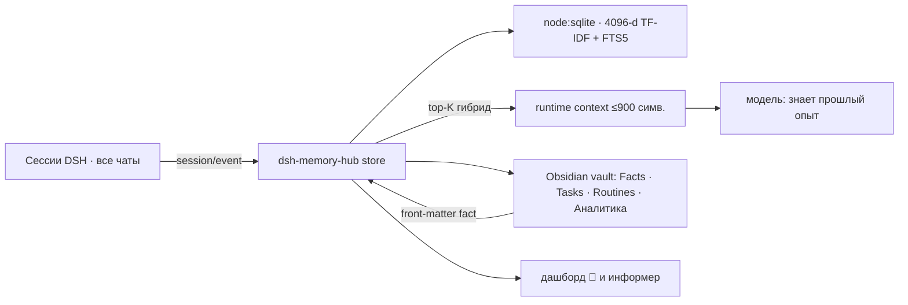

# dsh-memory-hub — общий контекст всех чатов и workspace

**RU** · [English](../en/dsh-memory-hub.md)

## RU

### Зачем

Память DeepSeek Harness была привязана к сессии: прошлые знания не переходили между чатами и
workspace, решённые задачи пересчитывались заново, повторяющиеся формулировки каждый раз разбирались
с нуля. Пакет закрывает это: одна общая база около профиля DSH, пополнение — автоматически,
подстановка в контекст — только актуальной части.

### Как это устроено ⚙️

  

1. **Ингест.** Каждый ход всех сессий складывается в SQLite: пользовательские запросы
   (`chat_user`), финальные ответы (`chat_assistant`), пары задача+решение (`task`), факты
   (`fact`) и vault-заметки (`doc`). Шум и служебные источники отфильтрованы; собственная
   инъекция не индексируется.
2. **Recall.** Запрос → вектор (hashed TF-IDF 4096-d, L2) → гибридный рэнк
   `0.68·cos + 0.32·coverage + бонус ws + свежесть` → топ-3 строк ≤ 900 символов.
3. **Рутины.** Нормализованный шаблон запроса; повтор 2+ раза → рутина с последним решением.
   При новом похожем запросе блок `<routine>` подставляется раньше обычного recall.
4. **Стиль.** Счётчики по ответам автора → `memory_style`; подсказка в системном промпте
   напоминает вызвать профиль перед статьями/постами.
5. **Аналитика.** Раз в 7 дней: графа зависимостей, мосты между workspace, решения и результаты,
   цели и незавершённые ходы, рекомендации → Obsidian `Аналитика/` + дашборд, `memory_analyze`.

### Настройка по шагам

1. **Установить пакет** — `install_bundle` из `packages/dsh-memory-hub`, перезапуск DSH.
2. **Vault.** `~/.dsh/obsidian/vault` создаётся автоматически; при желании откройте его в Obsidian
   («Open vault» → выбрать эту папку). Свои заметки — с front-matter `memory-hub: fact` в первых строках.
3. **Пороги и объём** — конфиг row `memory-hub`:

| Поле | По умолчанию | Смысл |
|---|---|---|
| `recallChars` | `900` | максимум символов подстановки |
| `recallLimit` | `3` | максимум строк recall |
| `minRecallScore` | `0.32` | порог попадания recall |
| `routineMinScore` | `0.45` | порог подстановки рутины |
| `autoMine` | `true` | майнер рутин по финализированным ходам |
| `weeklyAnalysis` | `true` | недельный анализ + отчёт в vault |
| `vaultSync` | `true` | запись в vault + обратная индексация заметок |
| `dbPath` / `vaultPath` | `$DSH_HOME/…` | пути хранилища и vault |

### Проверено ✅

- Инструменты `memory_save` → `memory_search` возвращают сохранённый факт; зеркальная заметка в vault.
- Дашборд-эндпоинты `/api/memory-hub/stats|analysis|run-analysis|run-mining` отвечают JSON'ом.
- Майнинг: повторившиеся формулировки превращаются в рутины с `uses = N`.
- Постановка контекста: блок `memory-hub:recall` в runtime-context сессии.

### Тонкости ⚠️

- Поиск — лексико-векторный: имена, пути и числа ловятся цепко, синонимы — по корню слова (4 симв.).
  Апгрейд-путь к e5-small оставлен: замена `embed(text, idf)`.
- Appreciated size: recall-блок оплачивается только при попадании; «пустой» шаг не добавляет токенов.
- Недельный анализ — эвристический (графа ко-встречаемости, незакрытые ходы); глубокий разбор делает
  агент поверх `memory_analyze` — он и возвращает полный markdown.

Безопасность и расположение данных: [Безопасность и секреты](security.md).
