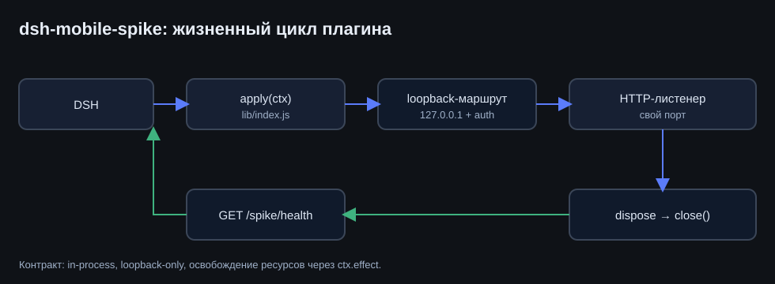
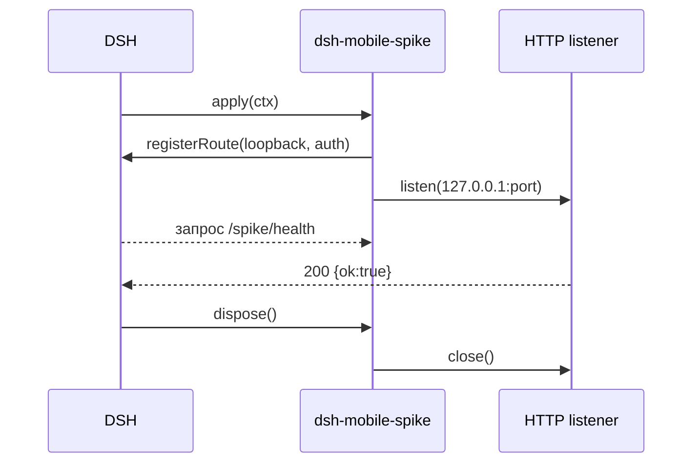

# dsh-mobile-spike — минимальный спайк DSH-плагина

<p align="center">
  
</p>

Экспериментальный прототип, который показывает, как устроен **in-process плагин DSH**:
точка входа Cordis, регистрация аутентифицированного loopback-маршрута, собственный
HTTP-листенер и корректное освобождение ресурсов при выгрузке. Использовался для
проверки контракта плагинов и стал основой `dsh-mobile`.

> Прототип, не для продакшена: публикуется как пример структуры плагина.

## Что показывает

| Элемент | Смысл |
|---|---|
| `lib/index.js` | вход с `name`, `inject`, `apply(ctx)` |
| `cordis.patch.yml` | корректный `insert` с `id`, `name`, `config` |
| loopback-маршрут | доступ только с `127.0.0.1`, с проверкой заголовка |
| `ctx.effect(() => dispose)` | освобождение листенера при выгрузке плагина |

## Жизненный цикл



## Запуск

```powershell
& "<DSH>\resources\runtime\cli\bin\dsh.cmd" plugin --profile desktop add `
    "link:<путь>\plugin-spike"
```

## Ограничения

- Порт выбирается свободный; в конфиге он не фиксируется.
- Нет UI и постоянного состояния — только контракт плагина.
- Для реальной работы смотрите `dsh-mobile`.
