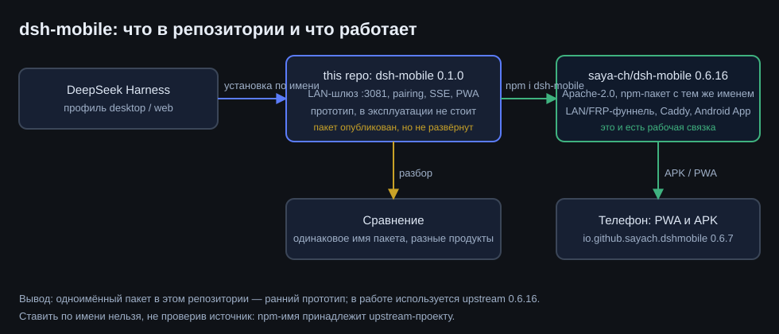
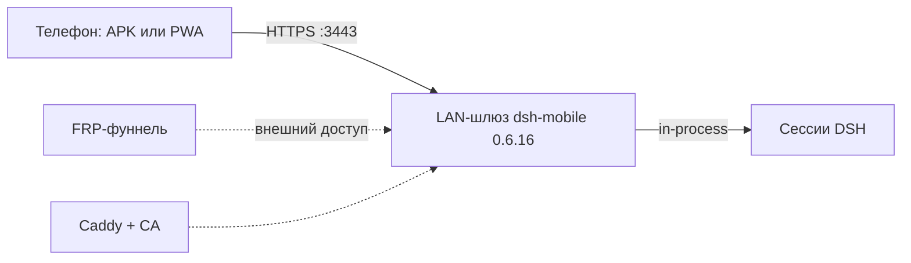

# dsh-mobile: что в репозитории и что работает

**RU** · [English](../en/dsh-mobile.md)



## Коротко

В репозитории лежит **ранний прототип** `packages/dsh-mobile` версии **0.1.0**: собственный LAN-шлюз на
`:3081`, pairing-коды, SSE-поток событий сессии и PWA без сборки. Он опубликован как пакет и остаётся
рабочим примером архитектуры, но **в эксплуатации не стоит**.

В работе используется **другой проект с тем же именем пакета** — upstream
[`saya-ch/dsh-mobile`](https://github.com/saya-ch/dsh-mobile) версии **0.6.16** (Apache-2.0): LAN/FRP-фуннель,
Caddy, Android-приложение `io.github.sayach.dshmobile` 0.6.7 и веб-клиент. Именно он установлен в профиль
DSH и настроен на этом стенде (шлюз `https://192.0.2.17:3443`, спаривание по коду, TLS с собственным CA).

| | Этот репозиторий | Рабочая связка |
|---|---|---|
| Пакет | `dsh-mobile` 0.1.0 (in-house) | `dsh-mobile` 0.6.16 (upstream, Apache-2.0) |
| Шлюз | LAN `:3081`, HTTP/HTTPS | LAN `:3443` + FRP-фуннель, Caddy |
| Клиент | PWA без сборки | APK `io.github.sayach.dshmobile` + PWA |
| Pairing | одноразовые коды, device-токены | коды + QR, CA на устройстве |
| Состояние | прототип, не развёрнут | развёрнут и проверен на телефоне |

## Почему так вышло

1. Прототип писался, чтобы понять контракт: как отдавать живую сессию на телефон, не тратя токены
   (только durable-журнал и шина событий).
2. Затем для эксплуатации был выбран upstream с готовым Android-клиентом и фуннелем — переизобретать
   мобильное приложение и обход NAT не потребовалось.
3. Имя пакета совпало: upstream публикуется как `dsh-mobile`, поэтому **устанавливать по имени нельзя** —
   `npm i dsh-mobile` притянет upstream, а не этот прототип.

## Как поставить прототип из этого репозитория

```bash
# копированием каталога, а не из реестра
git clone https://github.com/rukazax/deepseek_harness.git
cp -r deepseek_harness/packages/dsh-mobile ~/.dsh/profiles/desktop/node_modules/dsh-mobile
# затем прописать id плагина в cordis.patch.yml профиля и перезапустить DSH
```

## Как настроена рабочая связка (upstream)



- шлюз слушает `3443`, сертификат выпускается локальным CA, CA импортируется на телефон;
- спаривание — одноразовым кодом, устройство получает токен и запоминается;
- просмотр сессий не расходует токены LLM: плагин читает журнал сессии и события, не запуская генерацию.

## Безопасность

- pairing-коды одноразовые, с TTL и ограничением попыток; device-токены хранятся хешем;
- шлюз по умолчанию доступен только в LAN; внешний доступ — отдельным фуннелем, его нужно включать осознанно;
- в репозиторий не попадают токены, cookie и содержимое сессий;
- у прототипа (0.1.0) нет фуннеля и Android-клиента — это ограничение, а не «почти готово».

## Что делать, если нужен именно этот прототип

1. Ставить копированием каталога (см. выше), без публикации в реестр.
2. Проверять совместимость с текущей версией DSH: контракт плагинов меняется, `cordis.patch.yml`
   может требовать правок.
3. Не смешивать с upstream в одном профиле: одинаковое имя пакета, разные `lib/`.
