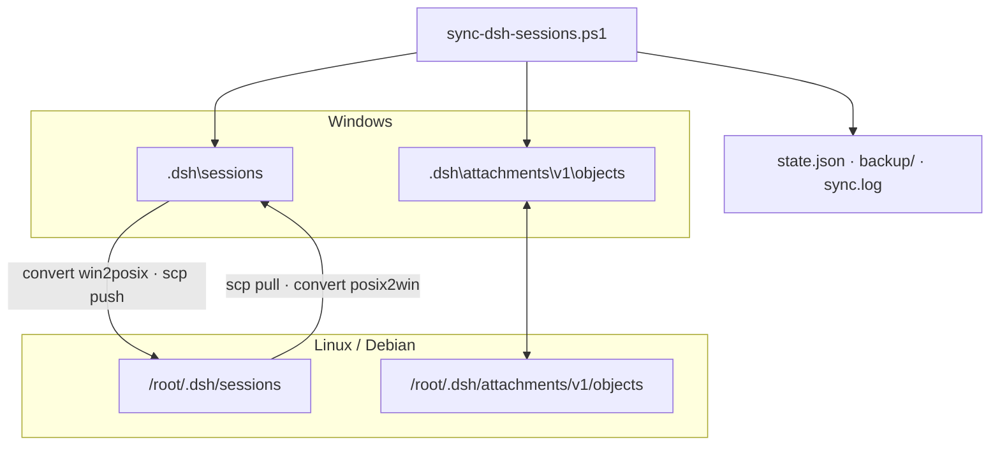

# dsh-sync: синхронизация истории сессий DSH

**RU** · [English](../en/dsh-sync.md) · [Пакет](../../packages/dsh-sync)

`dsh-sync` переносит историю сессий DeepSeek Harness между Windows-установкой и удалённым
Linux-инстансом: логи, вложения, служебные каталоги воркспейсов. Синхронизация не делает вызовов
моделей — это работа с файлами, `ssh`/`scp` и перепаковка zstd, поэтому токены не расходуются.

## 1. Задача

DSH хранит сессию как поток JSONL, сжатый Zstandard. Первый кадр — строка заголовка, в ней `cwd`
должен быть **абсолютным путём для текущей платформы**:

- на Windows это `C:\Users\<user>\Documents\deepseek-harness\<X>`;
- на Linux абсолютным считается путь, начинающийся с `/`.

Прямое копирование лога на другую платформу даёт заголовок, который принимающая сторона отвергает:
`readHeader` возвращает ошибку `format v2 header cwd must be absolute`, и сессия просто не появляется
в списке. Поэтому перенос состоит из двух шагов: правка заголовка и перепаковка кадра.

## 2. Что делает `convert.js`

1. Читает лог и разбирает zstd-кадры: первый содержит заголовок, остальные — события.
2. Разбирает JSON заголовка и заменяет `cwd` через карту префиксов (самый длинный совпавший префикс).
3. Пишет новый файл: первый кадр — ровно изменённая строка заголовка, дальше — исходные события
   без изменений.
4. Печатает JSON-отчёт: `id`, `from`, `to`, `target`, `events`, `bytes`, `sha256`, `changed`.

События не переписываются, поэтому формат v4 остаётся совместимым в обе стороны; проверено на 38
сессиях: удалённый инстанс читает историю, заголовки и токен-статистику.

Карта путей (значения по умолчанию, домашний каталог берётся из `USERPROFILE`):

| Windows | Linux |
|---|---|
| `C:\Users\<user>\Documents\deepseek-harness\` | `/root/dsh-ws/` |
| `C:\Users\<user>\` | `/root/win-home/` |
| `C:\` | `/root/win-c/` |

Если префикс не совпал, путь остаётся абсолютным для целевой платформы: `C:\X\Y` → `/root/win-c/X/Y`.

## 3. Оркестратор `sync-dsh-sessions.ps1`

Порядок одного прохода:

1. **Инвентаризация.** Локальные логи хэшируются, удалённые — через `remote-inventory.sh`
   (размеры + sha256).
2. **Направления.** Каждый лог сравнивается с `state.json`: изменилось только локально → push,
   только удалённо → pull, нигде → пропуск.
3. **Конвертация и передача.** Для push лог конвертируется `win2posix` и уезжает через `scp`;
   удалённая сторона принимает его `remote-push.sh` (staging → атомарная замена).
   Для pull — симметрично, `posix2win`.
4. **Конфликты.** Если файл изменился с обеих сторон, побеждает более новый; проигравший копируется
   в бэкап с меткой времени.
5. **Состояние.** В `state.json` записываются sha256 обеих сторон, в `sync.log` — строка журнала.

Флаги: `-DryRun` (показать план), `-ForceInitialPush` (первичная заливка без сравнения),
`-Quiet` (без вывода). Блокировка `sync.lock` не даёт двум проходам пересечься.

## 4. Установка и расписание

```
%USERPROFILE%\.dsh\bin\dsh-sync\        sync-dsh-sessions.ps1, convert.js
/root/dsh-sync/                         remote-inventory.sh, remote-push.sh, incoming/
```

- PowerShell 5.1+, OpenSSH-клиент, Node.js 22.15+ (Zstandard в `node:zlib`).
- SSH-алиас: `DSH_SYNC_SSH` (по умолчанию `debian17-root`), вход по ключу, `BatchMode=yes`.
- Задача Планировщика **«DSH Session Sync»**: при входе + каждые 5 минут, скрытый запуск.

Проверка:

```powershell
powershell -NoProfile -ExecutionPolicy Bypass -File sync-dsh-sessions.ps1 -DryRun
Get-ScheduledTaskInfo -TaskName 'DSH Session Sync' | Select LastRunTime,LastTaskResult
Get-Content "$env:USERPROFILE\.dsh\sync\sync.log" -Tail 20
```

## 5. Схема




## 6. Ограничения и диагностика

| Симптом | Причина | Что делать |
|---|---|---|
| Сессия не видна на другой стороне | заголовок не сконвертирован | проверить `-DryRun`, посмотреть отчёт `convert.js` |
| `node.exe not found` | нет Node 22.15+ | поставить Node или указать путь в PATH |
| `Permission denied (publickey)` | нет доступа по ключу | проверить `ssh <alias> true` |
| Конфликт «перезаписал сессию» | работа с двух сторон одновременно | взять файл из `backup/<время>` |
| Синхронизация «зависла» | остался `sync.lock` после сбоя | удалить `sync.lock`, запустить вручную |

Ограничения: append-only логи не сливаются при одновременной записи; удаления не распространяются;
на удалённой стороне без ключей LLM сессии доступны только для чтения.

## 7. Лицензия

MIT — см. [LICENSE пакета](../../packages/dsh-sync/LICENSE).
