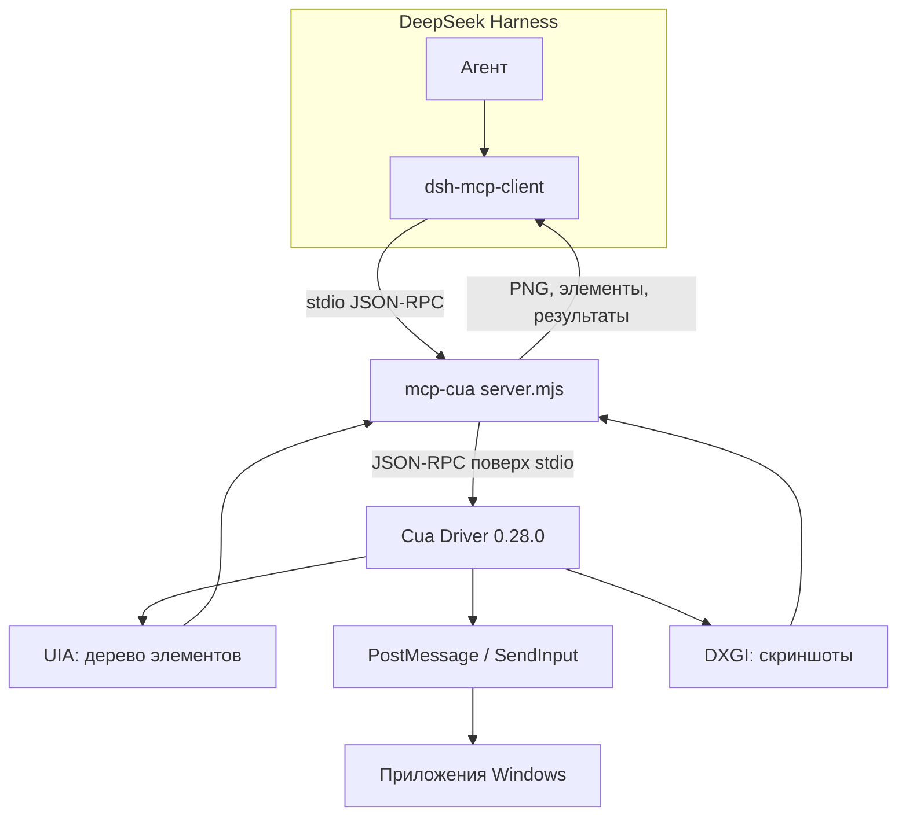

# mcp-cua — управление рабочим столом Windows из DSH

Сервер MCP (stdio), который отдаёт агенту DeepSeek Harness нативный computer use на Windows через
драйвер Cua 0.28.0.

## Назначение

Встроенный computer use в DSH есть только на macOS. На Windows его заменяет эта связка: агент видит
окна, дерево доступности, умеет нажимать кнопки, печатать, перетаскивать, читать буфер обмена и
снимать скриншоты — всё локально, без облака.

## Схема работы



Ключевое решение — **отдельный процесс**. Нативный драйвер работает вне DSH: если он упадёт,
сессия агента останется живой, а `dsh-mcp-client` перезапустит сервер.

## Инструменты

Курируемый набор (26) открыт по умолчанию; `--all` открывает все 56 инструментов драйвера.

| Группа | Инструменты |
|---|---|
| Обзор | `list_apps`, `list_windows`, `get_window_state`, `get_accessibility_tree`, `get_desktop_state`, `get_screen_size`, `zoom` |
| Запуск и окна | `launch_app`, `bring_to_front`, `set_window_frame`, `kill_app` |
| Действия | `click`, `double_click`, `right_click`, `drag`, `scroll`, `type_text`, `press_key`, `hotkey`, `set_value`, `invoke_menu` |
| Проверка | `verify_state`, `check_permissions`, `health_report` |
| Буфер обмена | `clipboard_read`, `clipboard_write` |

Каждый инструмент принимает либо `element_index`/`element_token` (предпочтительно), либо пиксельные
координаты в системе скриншота окна.

## Установка

```bash
# зависимости
cd ~/.dsh/bin/cua-mcp
pnpm install            # @trycua/cua-driver 0.28.0

# регистрация в профиле DSH
# mcp.servers.pc: command: node, args: [server.mjs]
```

Готовый фрагмент профиля — в `cordis.patch.yml` этого пакета.

## Режимы доставки ввода

| Режим | Как работает | Когда применять |
|---|---|---|
| `background` (по умолчанию) | UIA Invoke и PostMessage, окно не поднимается, фокус не отбирается | почти всегда |
| `foreground` | краткая активация окна и SendInput с возвратом фокуса | только после ошибки `background_unavailable` |

Правило простое: сначала пробовать `background`; драйвер сам сообщает, когда фон невозможен.

## Проверено

- Windows 11 x64, DSH 0.2.1-rc.2: инструменты видны как `mcp__pc__*`, снимок окна и клик по
  `element_index` работают, фокус не перехватывается;
- отказ драйвера не роняет DSH: сервер перезапускается клиентом.

## Ограничения

- Только Windows: на macOS нужен встроенный computer use, на Linux — свой драйвер (не проверялось).
- Поверхности Chromium/Electron могут требовать `foreground`: фоновые PostMessage туда не доходят.
- Минимизированное окно не снимается и не кликается, пока не поднято.
- Приватность: скриншоты уходят в модель, поэтому на экране не должно быть секретов.
