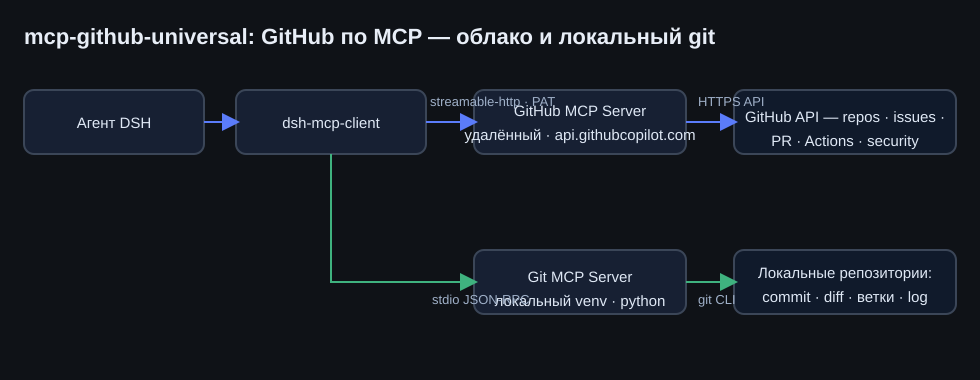

# mcp-github-universal — универсальный доступ к GitHub

**RU** · [English](../en/mcp-github-universal.md)

## RU

### Зачем

Работа с GitHub из DeepSeek Harness раньше шла узкими ходами: `git` в оболочке для локального
и ничего для облака. Пакет решает это раз и навсегда: один бандл, два MCP-сервера, полный набор
инструментов GitHub API плюс локальный git — без ручных скриптов на каждый случай.

### Состав

| Часть | Транспорт | Комментарий |
|---|---|---|
| Официальный удалённый GitHub MCP Server | `streamable-http` → `api.githubcopilot.com/mcp/x/all` | все toolsets: repos, issues, pull_requests, actions, code_security, discussions, users, gists и другие |
| `mcp-server-git` (reference-сервер MCP) | `stdio` из venv `~/.dsh/venvs/mcp-git` | статус, diff, коммиты, ветки, merge и log в локальных репозиториях |

<p align="center">
  
</p>

### Настройка по шагам

1. **Токен** 🔑. `github.com/settings/personal-access-tokens/new` → fine-grained PAT:
   `Contents`, `Issues`, `Pull requests` — Read and write, `Metadata` — read-only (включается сама),
   `Actions` — read, `Workflows` — Read and write для правки Actions-файлов. Классический токен:
   scopes `repo` + `workflow`.
2. **Переменная окружения.** Строка `GITHUB_PERSONAL_ACCESS_TOKEN=github_pat_...`
   в `~/.dsh/.env` — переменные снимаются при старте DSH, поэтому после правки — перезапуск
   DeepSeek Harness. Секрет в репозиторий не попадает.
3. **venv для локального Git-сервера.**

   ```bash
   python -m venv ~/.dsh/venvs/mcp-git
   ~/.dsh/venvs/mcp-git/Scripts/python -m pip install mcp-server-git    # Windows
   #    Linux: ~/.dsh/venvs/mcp-git/bin/python
   ```

4. **Установка пакета в профиль DSH** — `packages/mcp-github-universal/cordis.patch.yml`
   через `install_bundle`. Инструменты появляются в диалоге: `mcp__github__get_me`,
   `mcp__github__create_issue`, `mcp__git__git_status` и далее по списку.

### Конфигурация (ключевые поля)

| Поле | Значение | Смысл |
|---|---|---|
| `url` | `.../mcp/x/all` | все toolsets за один ход — можно сузить заголовком `X-MCP-Toolsets` |
| `headers.Authorization` | `Bearer <GITHUB_PERSONAL_ACCESS_TOKEN>` (через `!!js`) | токен из переменной окружения, не из файла пакета |
| `failOnStartupError` | `false` (github) / `true` (git) | без токена DSH стартует мягко; локальный сервер должен подниматься всегда |
| `reconnect` | 0,5 с → 30 с, до 10 попыток | после отвала GitHub пересоединяется сам |
| `toolCallTimeoutMs` | `120000` | длинным операциям (поиск по коду, логи Actions) хватает времени |

### Проверено ✅

- Вызов `mcp__github__get_me` возвращает аккаунт владельца токена — `rukazax`.
- Инструменты `mcp__git__*` регистрируются и отвечают на реальных репозиториях.
- Без токена github-часть не мешает работе: DSH стартует, инструменты просто отсутствуют.

### Права токена — грабли, на которые мы наступили 🪤

Fine-grained PAT по умолчанию не даёт запись в репозиторий: `permissions.push=true` в API — это
уровень аккаунта, а не токена. Запись решает только **Repository permissions → Contents → Read and write**
в карточке самого токена (и строка токена при этом не перевыпускается). Классический токен со
scope `repo` работает без этих тонкостей.

### Ротация и отзыв

Страница токенов GitHub → новый токен → обновить `GITHUB_PERSONAL_ACCESS_TOKEN` в `~/.dsh/.env` → перезапуск DSH.

### Тонкости ⚠️

- Ограничения лимитов GitHub API действуют так же, как для самого токена.
- Для приватных репозиториев достаточно, чтобы токен их покрывал.
- На Linux путь другой: `venvs/mcp-git/bin/python` вместо `Scripts/` — локальная копия патча
  знает об этом (см. `cordis.patch.yml`).

Безопасность токенов и другие общие пункты: [Безопасность и секреты](security.md).
