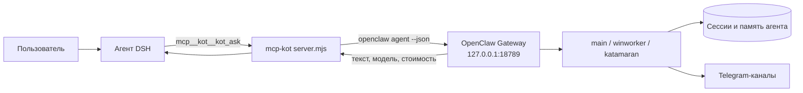

# mcp-kot — мост из DSH к агенту Kot (OpenClaw)

Сервер MCP (stdio), который отдаёт агенту DeepSeek Harness прямую линию к агенту Kot в OpenClaw:
передать запрос, получить ответ дословно и посмотреть состояние Gateway, каналов, агентов, сессий и
рабочих пространств.

## Назначение

DSH и OpenClaw решают разные задачи. DSH силён в файлах, командах и сборках; Kot держит долгую
координацию, приёмку и Telegram. Мост позволяет не переключать приложения: агент DSH вызывает Kot
инструментом и получает его ответ.

## Схема работы



Мост намеренно тонкий: он не дублирует логику OpenClaw, а вызывает его CLI и разбирает JSON-ответ.

## Инструменты

| Инструмент | Что делает |
|---|---|
| `kot_ask` | один ход агента: `prompt`, `workspace`, `session_key`, `agent`, `thinking`, `timeout_seconds`; возвращает текст, модель, стоимость |
| `kot_status` | версия Gateway, pid, число сессий, агенты, состояние каналов, деградировавшие плагины |
| `kot_channels` | Telegram-аккаунты: running/connected, режим, ошибки |
| `kot_agents` | агенты OpenClaw с рабочими каталогами и моделями |
| `kot_sessions` | последние сессии и чаты (агент, ключ, статус, время) |
| `kot_workspaces` | карта рабочих пространств DSH (путь, название, число чатов) |

## Сессии

Один `session_key` — одна непрерывная беседа. По умолчанию ключ выводится из имени папки
рабочего пространства (`dsh-<имя>`), поэтому у каждого проекта своя линия с Kot и своя история.

Практическое следствие: длинную задачу нельзя уложить в один вызов. Рабочий режим — короткое
поручение, затем короткий опрос статуса; задача живёт в сессии Kot и между вызовами не теряется.

## Установка

```bash
# требования: запущенный Gateway OpenClaw и CLI openclaw в PATH
# регистрация в профиле DSH: mcp.servers.kot → command: node, args: [server.mjs]
```

Готовый фрагмент — в `cordis.patch.yml` пакета. Инструменты появятся как `mcp__kot__*`.

## Проверено

- Gateway OpenClaw 2026.10.5, DSH 0.2.1-rc.2: `kot_status` отдаёт версию, агентов и состояние
  Telegram-каналов; `kot_ask` возвращает ответ агента с моделью и стоимостью;
- при выключенном Gateway инструменты возвращают понятную ошибку, а не зависают.

## Ограничения

- Нужен запущенный Gateway: без него мост бесполезен (это не замена, а связка).
- Таймаут по умолчанию — 840 секунд на ход; очень длинные задачи возвращаются частично.
- Ответ приходит текстом: вложения и файлы нужно забирать отдельными инструментами.
- Мост ничего не знает о содержимом переписки, кроме переданного `prompt`.
