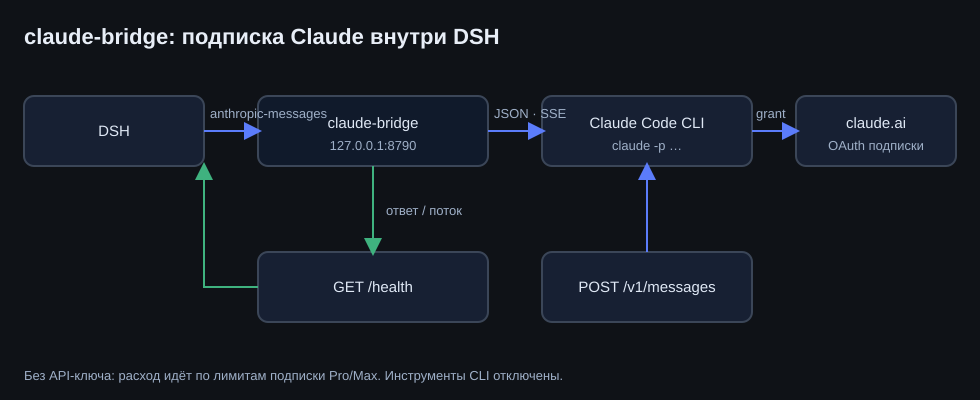
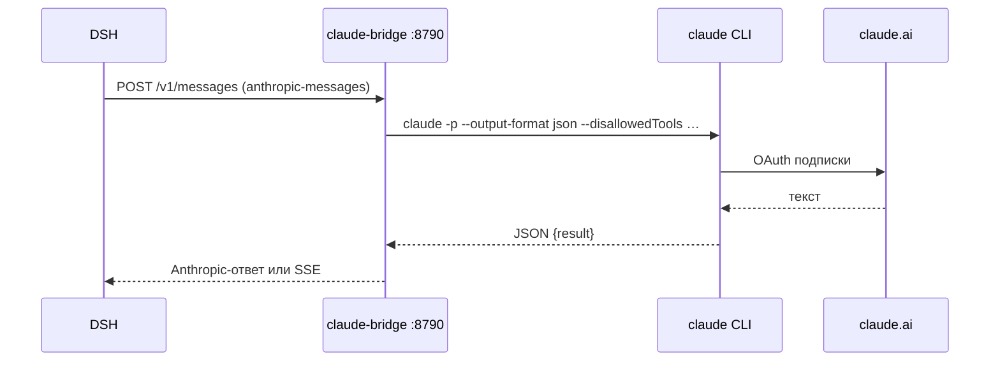
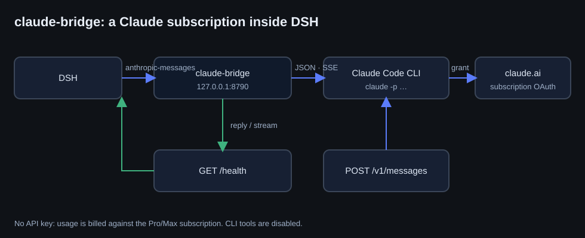

# claude-bridge

**RU** · [English](#english)

## RU

Локальный эндпоинт в формате **Anthropic Messages**, который выполняет запросы
через локальный **Claude Code CLI** и тем самым даёт DeepSeek Harness работать на
подписке **Claude Pro/Max** — без API-ключа и без оплаты по токенам.

<p align="center">
  
</p>

### Зачем

DSH принимает Anthropic только двумя путями: штатный провайдер по API-ключу или
«Свой API моделей» с протоколом `anthropic-messages`. Подписка Claude — это не ключ,
а OAuth-грант Claude Code (`~/.claude/.credentials.json`), который CLI обновляет сам.
Мост закрывает разрыв: слушает loopback, принимает запросы харнесса и передаёт их CLI.

### Как работает



- `POST /v1/messages` — обычный ответ и `stream: true` (SSE: `message_start`,
  `content_block_start`, `ping`, `content_block_delta`, `content_block_stop`,
  `message_delta`, `message_stop`).
- `GET /v1/models` — список моделей для селектора.
- `GET /health` — состояние CLI: `loggedIn`, `authMethod`.

### Установка

```powershell
# 1. Claude Code CLI и вход по подписке (один раз)
npm install -g @anthropic-ai/claude-code
claude auth login --claudeai

# 2. Мост + задача автозапуска + строка в профиле DSH
powershell -ExecutionPolicy Bypass -File .\install.ps1 -ProfilePatch

# 3. Проверка
curl http://127.0.0.1:8790/health
```

Голый сервер, без установщика:

```powershell
node .\claude-bridge.mjs --port 8790 --model sonnet
```

Флаги: `--port` (по умолчанию 8790), `--model` (алиас Claude: `sonnet`/`opus`/`haiku`),
`--timeout` (мс на один запуск CLI).

### Подключение в DSH

`cordis.patch.yml` этого пакета регистрирует маршрут в `llm-pi-ai`:

```yaml
- id: llm-pi-ai
  config:
    providers:
      claude-bridge:
        displayName: Claude (subscription)
        api: anthropic-messages
        baseURL: http://127.0.0.1:8790
        models:
          - id: claude-sonnet-5
            contextWindow: 200000
```

`providers` **заменяется целиком**: если в профиле уже есть другие маршруты
(`openai-codex`, `kimi-coding`, свои шлюзы) — перенесите их в этот же блок.

Дальше: Настройки → Модели → «Claude (subscription)» → `Claude Sonnet 5`.
Если маршрут не появился — перезапустите DSH: профиль читается при старте.

### Ограничения

- **Инструменты DSH не работают.** `claude` CLI не знает инструментов харнесса,
  поэтому в таком чате доступен только текст. Агент с инструментами — OpenClaw с
  провайдером `claude-cli`.
- Счётчик токенов DSH в этом чате показывает нули: расход идёт по лимитам подписки.
- Каждый запрос — отдельный запуск CLI: короткий ответ занимает 2–10 секунд.
- Контекст склеивается в один промпт: изображения, tool-вызовы и вложения не
  передаются; `system` и история сообщений сохраняются текстом.
- Только loopback: мост не слушает внешние интерфейсы и не требует ключа.

### Безопасность

Мост не читает и не хранит токены: OAuth-грант остаётся у CLI в `~/.claude`.
Инструменты CLI отключены (`--disallowedTools Bash,Edit,Write,Read,…`), чтобы модель
не пыталась читать файлы. Слушает `127.0.0.1`.

### Удаление

```powershell
powershell -ExecutionPolicy Bypass -File .\install.ps1 -Uninstall
```

И удалить блок `claude-bridge` из профиля (бэкап создаётся установщиком).

## English

A loopback endpoint speaking the **Anthropic Messages** protocol that executes
requests through the local **Claude Code CLI**, letting DeepSeek Harness run on a
**Claude Pro/Max subscription** — no API key, no per-token billing.

<p align="center">
  
</p>

### Why it exists

DSH reaches Anthropic either through an API key or through “custom model API” with the
`anthropic-messages` protocol. A Claude subscription is not a key: it is a Claude Code
OAuth grant (`~/.claude/.credentials.json`) that the CLI refreshes itself. The bridge
closes the gap — it listens on loopback, accepts harness requests and hands them to the CLI.

### Endpoints

| Route | Purpose |
|---|---|
| `POST /v1/messages` | Anthropic Messages, plain or `stream: true` (SSE event sequence) |
| `GET /v1/models` | model list for provider selectors |
| `GET /health` | CLI state: `loggedIn`, `authMethod` |

### Install

```powershell
npm install -g @anthropic-ai/claude-code
claude auth login --claudeai
powershell -ExecutionPolicy Bypass -File .\install.ps1 -ProfilePatch
curl http://127.0.0.1:8790/health
```

The installer checks node and the CLI, registers the **Claude Bridge** scheduled task
(at logon, restarts on failure), waits for `/health`, and with `-ProfilePatch` adds the
route to the DSH profile (backup first, idempotent).

### Limitations

- **DSH tools do not work**: the CLI does not know harness tools, so such a chat is
  text-only. For tool-using agents use OpenClaw with the `claude-cli` provider.
- Token counters in DSH read zero; usage goes against the subscription limits.
- One CLI process per request: 2–10 s for a short answer.
- Images and tool calls are not forwarded; `system` and message history are flattened
  into one prompt.
- Loopback only, no key required.

## License

MIT. See [LICENSE](LICENSE).
