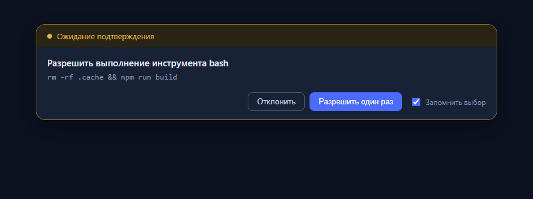

# dsh-approval-remember

<p align="center">
  
</p>

**RU** · [English](#english)

## RU

Клиентский плагин DeepSeek Harness, который добавляет в окно «Ожидание подтверждения» кнопку
**«Разрешать всегда»** — правее кнопок «Отклонить» и «Разрешить один раз», в той же строке.

Нажатие кнопки разрешает текущий запрос и запоминает правило для **этого и подобных сценариев**:
одинаковые по смыслу запросы (тот же тип действия) больше не спрашивают подтверждения.
Сценарий определяется по заголовку подтверждения с нормализацией: пути, URL, числа, кавычки и
пунктуация не влияют на совпадение.

### Поведение

- Кнопка вставляется в строку действий панели подтверждения (после «Разрешить один раз»).
- Клик: разрешает текущий запрос + сохраняет правило в `localStorage` (`dsh.approvalRules.v2`).
- Следующий подобный запрос: панель открывается с состоянием `✓ Разрешено всегда` и авто-подтверждается.
- Другой тип действия: спрашивает как обычно.
- Язык подписи: «Разрешать всегда» (RU) / «Always allow» (EN).
- Старые правила из версии с галочкой автоматически мигрируют.

### Установка

```powershell
# DSH должен быть закрыт
& "<DSH>\resources\runtime\cli\bin\dsh.cmd" plugin --profile desktop add `
    "link:<путь>\АМН\_plugins\dsh-approval-remember"
```

Перезапустите DSH: клиентские бандлы собираются при старте приложения.

### Управление правилами

В консоли DevTools (F12):

```js
window.__dshApprovalRemember.list()    // текущие правила (сигнатуры сценариев)
window.__dshApprovalRemember.clear()   // удалить все правила
```

### Безопасность

- Работает только в браузерном рендерере, в Host-процессе ничего не выполняется.
- Правила хранятся локально (localStorage), на сервер не передаются.
- Автоподтверждение срабатывает только при совпадении нормализованного сценария; остальные действия
  по-прежнему требуют явного разрешения.

### Лицензия

MIT.

---

## English

A DeepSeek Harness client plugin that adds an **"Always allow"** button to the
"Waiting for approval" panel — to the right of the "Reject" and "Allow once" buttons, in the same row.

Clicking it approves the current request and remembers the rule for **this and similar scenarios**:
requests of the same action class no longer ask for confirmation. The scenario is derived from the approval
headline with normalization, so paths, URLs, numbers, quotes and punctuation do not affect matching.

### Behavior

- The button is inserted into the approval action row (after "Allow once").
- Click: approves the current request and stores the rule in `localStorage` (`dsh.approvalRules.v2`).
- A later similar request opens with the `✓ Allowed always` state and is auto-approved.
- A different action class still asks as usual.
- The label is localized: "Разрешать всегда" (RU) / "Always allow" (EN).
- Rules from the earlier checkbox version migrate automatically.

### Install

```powershell
# DSH must be closed
& "<DSH>\resources\runtime\cli\bin\dsh.cmd" plugin --profile desktop add `
    "link:<path>\АМН\_plugins\dsh-approval-remember"
```

Restart DSH: client bundles are built at application startup.

### Managing rules

In the DSH web DevTools console (F12):

```js
window.__dshApprovalRemember.list()    // current scenario rules
window.__dshApprovalRemember.clear()   // remove all rules
```

### Security

- Runs in the browser renderer only; nothing executes in the Host process.
- Rules are stored locally (localStorage) and never sent to a server.
- Auto-approval fires only on a matching normalized scenario; other actions still require explicit consent.

### License

MIT.
