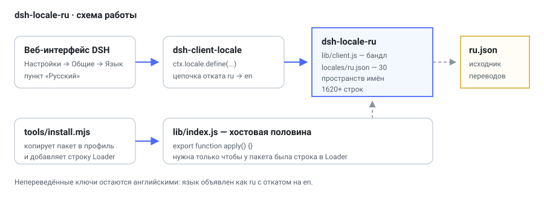
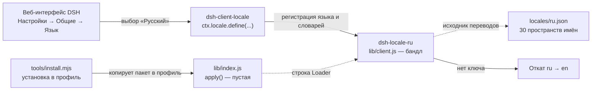
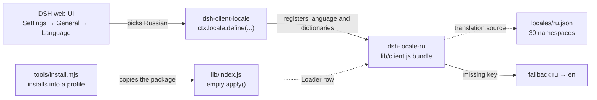

# dsh-locale-ru — русский язык для веб-интерфейса DSH

<p align="center">
  
</p>

**RU** · [English](#english)

## RU

Клиентский плагин DeepSeek Harness: добавляет в «Настройки → Общие → Язык» пункт **«Русский»** и
регистрирует русские словари для всех клиентских пакетов интерфейса.

- **1620+ строк** перевода в **30 пространствах имён** — все английские словари, извлечённые из
  установленного DSH (`app.asar`).
- Непереведённые ключи (например, из более новой версии DSH) остаются английскими: у языка объявлена
  цепочка отката `ru → en`.
- Зависимостей нет, сборка не нужна: браузерная половина — один самодостаточный файл `lib/client.js`.
- Хостовая половина (`lib/index.js`) намеренно пустая: у пакета должна быть строка в Loader, но
  никаких сервисов она не занимает и безопасна для включения/отключения из настроек.

### Как это работает



`dsh-client-modules` обходит активные строки Loader, у каждой читает объявленный язык и словари.
Плагин регистрирует язык `ru` с цепочкой отката на `en`, поэтому отсутствующий перевод не ломает
интерфейс — строка показывается на английском.

### Состав

| Файл | Назначение |
|---|---|
| `package.json` | Манифест: `dsh.bundle.patch`, `dsh.client`, `exports["./client"]` |
| `cordis.patch.yml` | Строка Loader для монтирования плагина |
| `lib/index.js` | Хостовая половина: пустой `apply`, без сервисов |
| `lib/client.js` | Собранный браузерный бандл: язык и все словари |
| `locales/ru.json` | Исходник перевода: `пакет → ключ → русский текст` |
| `tools/install.mjs` | Установка/удаление в профиле DSH одной командой |

### Установка

```bash
# 1) сухой прогон: показывает, что будет скопировано и какая строка добавится
node tools/install.mjs --dry-run

# 2) установка в профиль desktop (по умолчанию)
node tools/install.mjs

# 3) удаление
node tools/install.mjs --remove
```

Скрипт копирует пакет в `~/.dsh/profiles/<профиль>/plugins/dsh-locale-ru` и добавляет одну строку
Loader в `cordis.patch.yml` профиля, сохраняя резервную копию. Без pnpm, без сети, без пересборки.

Альтернатива — вручную: скопировать каталог пакета в `plugins/` профиля и добавить

```yaml
- insert:
    - id: dsh-locale-ru
      name: dsh-locale-ru
```

### Проверка результата

1. Перезапустить DSH (или обновить окно) и открыть «Настройки → Общие → Язык».
2. Убедиться, что появился пункт «Русский»; выбрать его.
3. Интерфейс переключается на русский; непереведённые строки остаются английскими.

### Ограничения

- Перевод соответствует словарям версии DSH, из которой он извлечён: в новых версиях часть ключей
  может отсутствовать и отображаться на английском — это ожидаемое поведение отката.
- Плагин не переводит содержимое, которое генерирует модель, и имена инструментов.

---

## English

DeepSeek Harness client plugin: adds a **«Русский»** (Russian) entry under
Settings → General → Language and registers Russian dictionaries for every client package of the UI.

- **1620+ translated lines** across **30 namespaces** — every English dictionary extracted from the
  installed DSH bundle (`app.asar`).
- Missing keys (for example from a newer DSH build) stay English: the language declares a
  `ru → en` fallback chain.
- No dependencies and no build step: the browser half is a single self-contained `lib/client.js`.
- The host half (`lib/index.js`) is intentionally empty: the package needs a Loader row, but claims no
  services, so it can be enabled and disabled from settings safely.

### How it works



`dsh-client-modules` walks the active Loader rows and reads the declared language and dictionaries.
The plugin declares language `ru` with an `en` fallback, so a missing translation never breaks the
interface — that string is rendered in English.

### Contents

| File | Purpose |
|---|---|
| `package.json` | Manifest: `dsh.bundle.patch`, `dsh.client`, `exports["./client"]` |
| `cordis.patch.yml` | Loader row that mounts the plugin |
| `lib/index.js` | Host half: empty `apply`, no services |
| `lib/client.js` | Built browser bundle: language plus all dictionaries |
| `locales/ru.json` | Translation source: `package → key → Russian text` |
| `tools/install.mjs` | One-command install/remove in a DSH profile |

### Install

```bash
node tools/install.mjs --dry-run   # show what would change
node tools/install.mjs             # install into the desktop profile
node tools/install.mjs --remove    # uninstall
```

The script copies the package into `~/.dsh/profiles/<profile>/plugins/dsh-locale-ru`, adds one Loader
row to the profile `cordis.patch.yml` and keeps a backup. No pnpm, no network, no rebuild.

Manual alternative: copy the package directory into the profile `plugins/` folder and add

```yaml
- insert:
    - id: dsh-locale-ru
      name: dsh-locale-ru
```

### Verify

1. Restart DSH (or reload the window) and open Settings → General → Language.
2. The «Русский» entry is present; select it.
3. The interface switches to Russian; untranslated strings stay English.

### Limitations

- The translation matches the dictionaries of the DSH build it was extracted from: newer builds may add
  keys that are absent here and therefore render in English — that is the expected fallback behaviour.
- The plugin does not translate model output or tool names.

## License

MIT — see [LICENSE](LICENSE).
