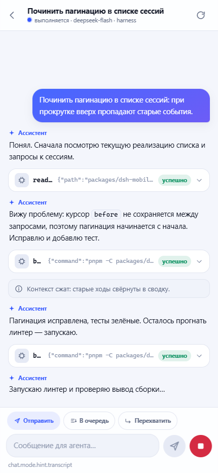
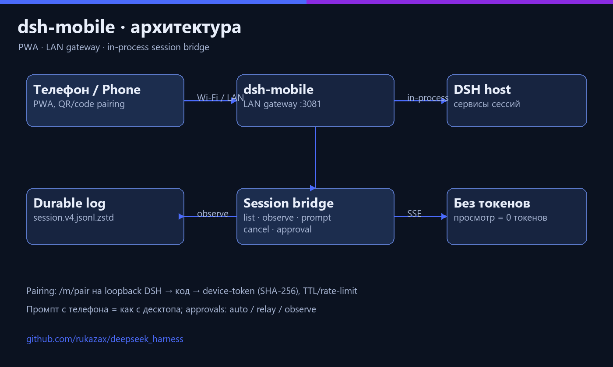
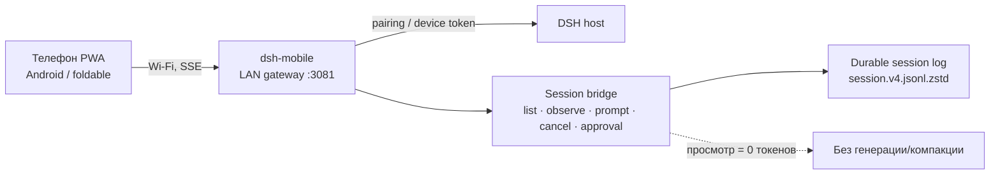
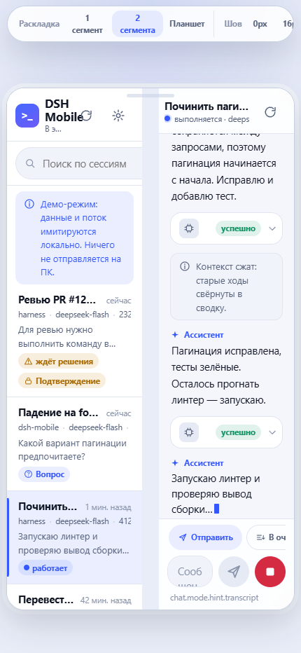
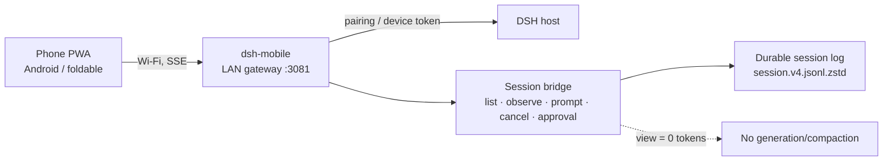

# dsh-mobile — DSH Mobile Remote

<p align="center">
  
</p>

**RU** · [English](#english)

## RU

Плагин DeepSeek Harness, превращающий телефон (Android/раскладной) в пульт управления живыми
сессиями агента: список сессий, история, промпты, остановка, approvals — через собственный LAN-шлюз
с pairing-кодами. Просмотр сессий с телефона **не расходует токены**: плагин читает только durable-журнал
сессии и шину событий, не активируя холодные сессии и не запуская генерацию заголовков.

### Возможности

- LAN-шлюз (`:3081`) с HTTP/HTTPS, JSON-конвертом, gzip/br, ETag и CORS.
- Pairing: страница `/m/pair` на loopback DSH, одноразовые коды (TTL, попытки, rate-limit), device-токены (SHA-256).
- Список сессий, окно истории, живой поток событий (SSE) с heartbeat и backpressure.
- Промпты, очередь, остановка, approvals (`auto | relay | observe`).
- PWA без сборки и внешних зависимостей: адаптация под раскладной экран (`?demo=1&lab=1`).
- In-process мост к сервисам хоста: `list / observe / prompt / cancel / approval`.

### Архитектура

<p align="center">
  
</p>



### Установка

```powershell
# DSH должен быть закрыт
& "<DSH>\resources\runtime\cli\bin\dsh.cmd" plugin --profile desktop add `
    "link:<путь>\harness\packages\dsh-mobile"
```

После запуска DSH: `http://127.0.0.1:<порт DSH>/m/pair` — код и LAN-адреса;
на телефоне — `http://<LAN-IP>:3081/`.

### Конфигурация

```yaml
- id: mobile-remote
  name: dsh-mobile
  config:
    listenPort: 3081
    pairingTtlSec: 300
    approvals: auto     # auto | relay | observe
    sessionWindowTurns: 1
    sessionWindowEvents: 40
    debug: false
```

### Состав

```
lib/index.js          Cordis-вход: listener, /m/pair, файловый лог, ленивый мост, dispose
src/config.js         нормализация конфига
src/auth.js           pairing-коды, device-токены (SHA-256)
src/store.js          атомарный JSON-реестр устройств ($DSH_HOME/mobile-remote)
src/http.js           JSON-конверт, ошибки, gzip/br, ETag, CORS, лимиты
src/static.js         отдача PWA (path-traversal-safe)
src/sse.js            SSE-hub: поток на (device, session), heartbeat, backpressure
src/routes.js         /api/v1: auth, идемпотентность, сессии, approvals, jobs
src/server.js         LAN-слушатель, роутинг, graceful shutdown
src/pairing.js        HTML-страница /m/pair
src/session-bridge.js in-process мост: list/observe/page/prompt/cancel/approval
web/                  PWA без сборки
test/                 node:test (20 тестов, in-process runner)
```

### Проверка

```powershell
& "<bundled-node>" scripts/run-tests.mjs
```

### Скриншоты

| Чат с телефона | Раскладной экран |
|---|---|
|  |  |

### Безопасность

- Слушает только LAN; pairing-коды одноразовые, с TTL и ограничением попыток.
- Device-токены хранятся в виде SHA-256-хешей; в репозитории секретов нет.
- Плагин не активирует холодные сессии и не вызывает генерацию токенов при просмотре.

### Лицензия

MIT.

---

## English

A DeepSeek Harness plugin that turns a phone (Android/foldable) into a remote control for live agent
sessions: session list, history, prompts, stop, approvals — over its own LAN gateway with pairing codes.
Viewing sessions from the phone costs **zero tokens**: it reads only the durable session log and the event bus,
without activating cold sessions or triggering title generation.

### Features

- LAN gateway (`:3081`) with HTTP/HTTPS, JSON envelope, gzip/br, ETag and CORS.
- Pairing: `/m/pair` page on the DSH loopback, one-time codes (TTL, attempts, rate limit), device tokens (SHA-256).
- Session list, history window, live event stream (SSE) with heartbeat and backpressure.
- Prompts, queueing, stop, approvals (`auto | relay | observe`).
- Build-free PWA with no external dependencies; foldable screen adaptation (`?demo=1&lab=1`).
- In-process bridge to host services: `list / observe / prompt / cancel / approval`.

### Architecture

<p align="center">
  
</p>



### Install

```powershell
# DSH must be closed
& "<DSH>\resources\runtime\cli\bin\dsh.cmd" plugin --profile desktop add `
    "link:<path>\harness\packages\dsh-mobile"
```

After DSH starts: `http://127.0.0.1:<DSH port>/m/pair` — code and LAN addresses;
on the phone — `http://<LAN-IP>:3081/`.

### Configuration

See the YAML above; all fields are optional.

### Layout

`lib/` entry, `src/` gateway/auth/store/http/static/sse/routes/server/pairing/session-bridge,
`web/` build-free PWA, `test/` node:test suite (20 in-process tests).

### Verify

```powershell
& "<bundled-node>" scripts/run-tests.mjs
```

### Screenshots

| Phone chat | Foldable screen |
|---|---|
|  |  |

### Security

- LAN-only listener; one-time pairing codes with TTL and attempt limits.
- Device tokens are stored as SHA-256 hashes; no secrets in the repository.
- Viewing does not activate cold sessions or spend model tokens.

### License

MIT.
