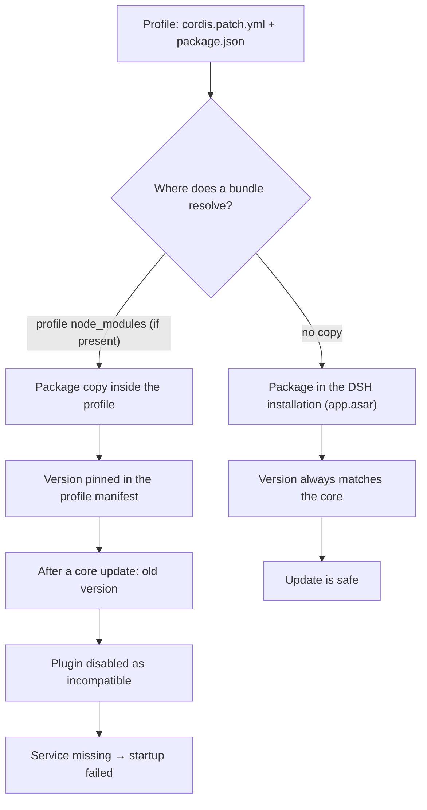
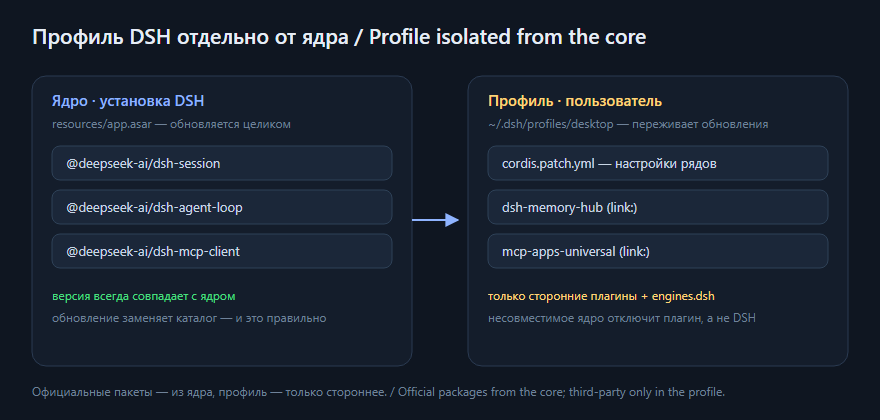

# dsh-profile-doctor

Keep a DeepSeek Harness profile isolated from the core: one command to check and repair.

The tool answers a single question: **will this profile survive the next DSH update?** It finds and removes everything that makes the core fail to start after an upgrade, and keeps official packages resolved from the installation while third-party plugins stay separate.

---

## 🧯 Why this exists

On 2026-11-16 the desktop app updated to `0.2.2-rc.3` and refused to start:

```text
dsh: startup failed: 1 required plugin did not activate
Plugins waiting for services (22):
  agent-loop (required)   sessions
  session-title           sessions
  schedule                sessions, storageDomain
  …
```

The cause was not a user plugin but profile shadows. Profile modules resolve **before** installation modules, and the profile still carried copies of official packages pinned to `0.2.2-rc.1`. After the update `@deepseek-ai/dsh-session@0.2.2-rc.1` no longer satisfied the core, the compatibility gate disabled that row, so the `sessions` service was never provided. The required `agent-loop` waited for `sessions` while `dsh-session` was already disabled: startup aborted.

A second amplifier was `compatibility.json` (one-off exemptions): it held 70 grants such as `@deepseek-ai/dsh-session@0.2.2-rc.1 → 0.2.2-rc.2` that no longer applied after the move to `rc.3` but still authorised old versions in other combinations.

Conclusion: **the more copies of the core a profile holds, the more reasons it has to fail after an update**.

---

## 🧭 How DSH resolves packages





Hence the invariant the doctor maintains:

| Rule | Why |
|---|---|
| No `@deepseek-ai/*` packages in profile `dependencies` | the installation already ships them; a profile copy overrides updates |
| Nothing under `profile/node_modules/@deepseek-ai/` | a shadow copy wins the resolution race against the core |
| No `compatibility.json` | one-off exemptions re-enable incompatible versions |
| No retired bundles in `dsh.profile.bundles` | the installer removes them itself; leftovers only confuse loading |
| Third-party plugins declare `engines.dsh` | an incompatible core disables the plugin instead of crashing DSH |

---

## ⚡ Quick start

```powershell
# check only (changes nothing)
D:\DeepSeek\PC_Admin\dsh-profile-doctor\run-doctor.cmd

# JSON report for another profile
run-doctor.cmd --profile desktop --json

# repair: manifest, shadows, exemptions, pnpm install
run-doctor.cmd --fix
```

`run-doctor.cmd` locates `node.exe` inside the DSH installation, so a separate Node.js is not required. For a non-standard install location set `PROFILE_DOCTOR_INSTALL` or pass `--install "<path>"`.

### Options

| Option | Meaning |
|---|---|
| `--profile <name>` | profile name, `desktop` by default |
| `--install <dir>` | DeepSeek Harness install directory (auto-detected by default) |
| `--home <dir>` | `DSH_HOME` directory, `~/.dsh` by default |
| `--fix` | apply repairs |
| `--no-install` | with `--fix`, skip `pnpm install` |
| `--json` | machine-readable report |

Exit codes: `0` healthy and isolated, `1` problems found, `2` installation or profile not found.

---

## 👀 What the report looks like

```text
DSH core: 0.2.2-rc.3
Install:  C:\Users\…\Programs\DeepSeek Harness
Profile:  C:\Users\…\.dsh\profiles\desktop (desktop)

[OK] Official packages in profile dependencies
[OK] @deepseek-ai/* copies in profile/node_modules
[!!] compatibility.json (one-off exemptions)
       file present, grants: 70, not for the current core: 70
       → an exemption re-authorises a known-incompatible plugin
[OK] Retired bundles
[OK] Profile plugin compatibility with the core

Problems found. Re-run with --fix to repair.
```

With `--fix` the same report is recomputed after the repairs, so a second run simply confirms the state.

---

## 🔁 Routine after a DSH update

1. Run `run-doctor.cmd`. All `[OK]` means nothing to do.
2. Any `[!!]` → run `run-doctor.cmd --fix`, then restart the app.
3. A third-party plugin reported as incompatible must be updated, or its `engines.dsh` widened deliberately after verifying it on the new core — never by granting an exemption.

An exemption in `compatibility.json` is the last resort: it authorises known-incompatible code. That is exactly why the doctor deletes the file.

### Ready-to-paste prompt for a fresh session

When the app already fails to start and you need an agent to walk the whole path: [prompts/heal-profile-isolation.en.md](prompts/heal-profile-isolation.en.md) (RU — [prompts/heal-profile-isolation.md](prompts/heal-profile-isolation.md)). The file carries two versions: a step-by-step one and a one-line one.

---

## 🧩 What stays in a profile

Only what the installation does not ship: local bundles (`link:`/`file:`), third-party npm packages and the user `cordis.patch.yml`. Everything official comes from the core.

The "did something come back" check is part of the same run: if the plugin manager installs a copy into the profile again when a bundle is toggled, the doctor reports it and removes it.

---

## 📄 License

MIT. Part of [rukazax/deepseek_harness](https://github.com/rukazax/deepseek_harness).
