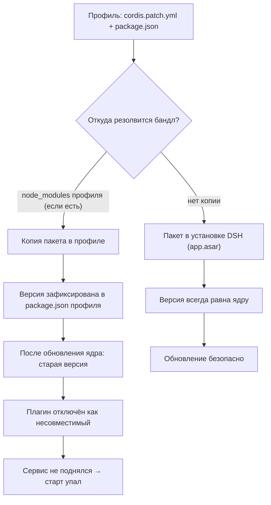
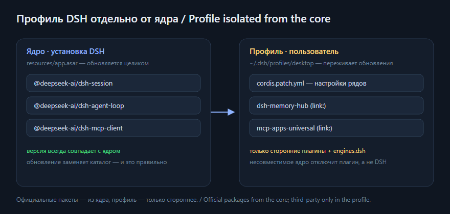

# dsh-profile-doctor

Профиль DeepSeek Harness, отделённый от ядра: проверка и починка одной командой.

Инструмент отвечает на один вопрос: **переживёт ли профиль следующее обновление DSH**. Он находит и убирает то, из-за чего ядро падает на старте после апдейта, и держит профиль в состоянии, где официальные пакеты всегда приходят из ядра, а сторонние плагины живут отдельно.

---

## 🧯 Что произошло (почему инструмент появился)

16.11.2026 приложение обновилось до `0.2.2-rc.3` и не запустилось:

```text
dsh: startup failed: 1 required plugin did not activate
Plugins waiting for services (22):
  agent-loop (required)   sessions
  session-title           sessions
  schedule                sessions, storageDomain
  …
```

Причина не в плагинах пользователя, а в их тенях. Модули профиля резолвятся **раньше** модулей установки, а в профиле лежали копии официальных пакетов, закреплённые на `0.2.2-rc.1`. После обновления `@deepseek-ai/dsh-session@0.2.2-rc.1` перестал быть совместимым с ядром, механизм совместимости его отключил — и сервис `sessions` не появился ни у кого. Обязательный `agent-loop` ждал `sessions`, а `dsh-session` был уже выключен: старт прервался.

Дополнительный усилитель — файл `compatibility.json` (разовые исключения): в нём висели 70 разрешений вида `@deepseek-ai/dsh-session@0.2.2-rc.1 → 0.2.2-rc.2`, которые после перехода на `rc.3` уже не действовали, но продолжали разрешать старые версии в других сочетаниях.

Вывод: **чем больше копий ядра в профиле, тем больше поводов не запуститься после обновления**.

---

## 🧭 Как DSH ищет пакеты





Отсюда инвариант, который поддерживает доктор:

| Правило | Почему |
|---|---|
| В `dependencies` профиля нет пакетов `@deepseek-ai/*` | они уже поставляются установкой, копия в профиле перекрывает обновление |
| В `profile/node_modules/@deepseek-ai/` ничего нет | теневая копия перехватывает резолв до ядра |
| Нет `compatibility.json` | разовые исключения вновь включают несовместимые версии |
| Нет выведенных бандлов в `dsh.profile.bundles` | установщик сам удаляет их из профиля, остаток только мешает |
| У сторонних плагинов объявлен `engines.dsh` | несовместимое ядро отключает плагин аккуратно, а не роняет DSH |

---

## ⚡ Быстрый старт

```powershell
# проверка (ничего не меняет)
D:\DeepSeek\PC_Admin\dsh-profile-doctor\run-doctor.cmd

# проверка конкретного профиля в JSON
run-doctor.cmd --profile desktop --json

# починка: манифест, тени, исключения, pnpm install
run-doctor.cmd --fix
```

`run-doctor.cmd` сам находит `node.exe` внутри установки DSH — отдельный Node.js не нужен. Если приложение стоит в нестандартном каталоге, задайте `PROFILE_DOCTOR_INSTALL` или передайте `--install "<путь>"`.

### Параметры

| Параметр | Значение |
|---|---|
| `--profile <name>` | профиль, по умолчанию `desktop` |
| `--install <dir>` | каталог установки DeepSeek Harness (по умолчанию автоопределение) |
| `--home <dir>` | каталог `DSH_HOME`, по умолчанию `~/.dsh` |
| `--fix` | исправить найденное |
| `--no-install` | с `--fix` не запускать `pnpm install` |
| `--json` | машиночитаемый отчёт |

Коды возврата: `0` — профиль отделён от ядра, `1` — есть проблемы, `2` — установка или профиль не найдены.

---

## 👀 Как выглядит отчёт

```text
Ядро DSH: 0.2.2-rc.3
Установка: C:\Users\…\Programs\DeepSeek Harness
Профиль:   C:\Users\…\.dsh\profiles\desktop (desktop)

[OK] Официальные пакеты в зависимостях профиля
[OK] Копии @deepseek-ai/* в profile/node_modules
[!!] compatibility.json (разовые исключения совместимости)
       файл есть, исключений: 70, не про текущее ядро: 70
       → исключение вновь разрешает заведомо несовместимый плагин
[OK] Выведенные из обращения бандлы
[OK] Совместимость профильных плагинов с ядром

Есть проблемы. Повторите с --fix, чтобы исправить.
```

С `--fix` тот же отчёт пересчитывается после правок, поэтому повторный запуск просто подтверждает состояние.

---

## 🔁 Порядок после обновления DSH

1. Запустить `run-doctor.cmd` — если всё `[OK]`, ничего делать не нужно.
2. Если есть `[!!]` — выполнить `run-doctor.cmd --fix` и перезапустить приложение.
3. Если сторонний плагин помечен несовместимым (`[!!]` в последней проверке) — обновить плагин или осознанно расширить его `engines.dsh`, а не выдавать исключение.

Исключение `compatibility.json` — последнее средство: оно разрешает заведомо несовместимый код. Доктор удаляет файл именно поэтому.

---

## 🧩 Что остаётся в профиле

Только то, что не поставляет установка: локальные бандлы (`link:`/`file:`), сторонние npm-пакеты, пользовательский `cordis.patch.yml`. Всё официальное — из ядра.

Проверка «а не вернулось ли лишнее» выполняется тем же запуском: если менеджер плагинов при включении бандла снова поставил копию в профиль, доктор покажет её и уберёт.

---

## 📄 Лицензия

MIT. Часть репозитория [rukazax/deepseek_harness](https://github.com/rukazax/deepseek_harness).
