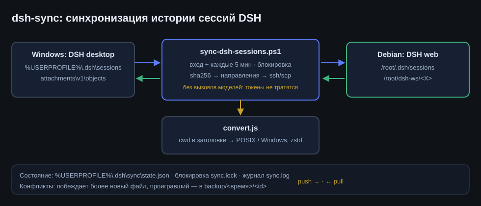
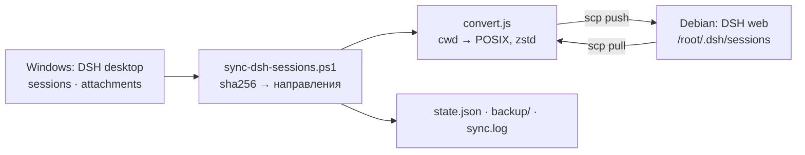
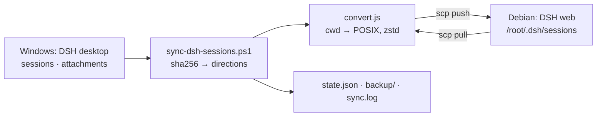

# dsh-sync

**RU** · [English](#english)

## RU

Двусторонняя синхронизация истории сессий **DeepSeek Harness** между Windows-установкой и удалённым
Linux-инстансом (Debian). Переносятся логи сессий и вложения; вызовов моделей нет — тратятся только
файлы, `ssh`/`scp` и перепаковка zstd, поэтому токены не расходуются.

Зачем нужна конвертация: DSH требует, чтобы `cwd` в заголовке сессии был **абсолютным путём для своей
платформы**. Windows-путь `C:\Users\...` на Linux абсолютным не является, и инстанс считает такой лог
«malformed» и молча скрывает его. `convert.js` переписывает только строку заголовка через карту путей
и заново упаковывает лог так, как ждёт JSONL-бэкенд: первый zstd-кадр — ровно заголовок, дальше события.
Сами события не меняются.

### Что синхронизируется

| Данные | Windows | Linux |
|---|---|---|
| Логи сессий | `%USERPROFILE%\.dsh\sessions\` | `/root/.dsh/sessions/` |
| Вложения (картинки и т.п.) | `%USERPROFILE%\.dsh\attachments\v1\objects\` | `/root/.dsh\attachments\v1\objects\` |

Реестр рабочих папок (`storages\workspace.json`) **не** синхронизируется: у каждого инстанса он свой.

### Сопоставление путей

```
C:\Users\<user>\Documents\deepseek-harness\<X>   <->   /root/dsh-ws/<X>
C:\Users\<user>\<Y>                              <->   /root/win-home/<Y>
C:\<Z>                                           <->   /root/win-c/<Z>
```

Каталоги `/root/dsh-ws/<X>` создаются автоматически при первой синхронизации.

### Направления и конфликты

- Изменение определяется по `sha256` лога и сравнивается с последним синхронизированным состоянием (`state.json`).
- Изменилось только на ПК → **push**; только на удалённой стороне → **pull**.
- Изменилось с обеих сторон → побеждает более новый файл, проигравший сохраняется в бэкап:
  `%USERPROFILE%\.dsh\sync\backup\<время>\<id>\` и `/root/.dsh/sync-backup/<время>/<id>/`.
- Удаления не распространяются: пропавшая с одной стороны сессия остаётся на другой.

### Требования

- Windows PowerShell 5.1+, клиент OpenSSH (`ssh`, `scp`) в PATH;
- Node.js **22.15+** (нужен `zlib` с поддержкой Zstandard) — на Windows берётся из PATH или из встроенного
  рантайма DSH;
- SSH-доступ к удалённому инстансу по ключу, без пароля; алиас задаётся в `~/.ssh/config`
  (по умолчанию `debian17-root`, переопределяется переменной `DSH_SYNC_SSH`);
- на удалённой стороне — установленный DSH и каталог `/root/dsh-sync/` с серверными хелперами.

### Установка

```powershell
# 1) скопировать пакет на ПК, например в %USERPROFILE%\.dsh\bin\dsh-sync
# 2) положить серверные хелперы на удалённую машину
scp remote-inventory.sh remote-push.sh root@host:/root/dsh-sync/
# 3) проверить план без изменений
powershell -NoProfile -ExecutionPolicy Bypass -File sync-dsh-sessions.ps1 -DryRun
```

Расписание — задача Планировщика Windows **«DSH Session Sync»**: при входе пользователя и каждые 5 минут,
скрыто:

```powershell
schtasks /create /tn "DSH Session Sync" /sc minute /mo 5 /ru $env:USERNAME ^
  /tr "powershell.exe -NoProfile -ExecutionPolicy Bypass -WindowStyle Hidden -File %USERPROFILE%\.dsh\bin\dsh-sync\sync-dsh-sessions.ps1"
```

Проверка и отключение:

```powershell
Get-ScheduledTask -TaskName 'DSH Session Sync' | Select TaskName,State
Start-ScheduledTask -TaskName 'DSH Session Sync'
Disable-ScheduledTask -TaskName 'DSH Session Sync'
```

### Схема работы





### Файлы

| Файл | Назначение |
|---|---|
| `sync-dsh-sessions.ps1` | оркестратор: инвентаризация, направления, конвертация, бэкапы, блокировка |
| `convert.js` | конвертер логов и путей (запускается на обеих сторонах) |
| `remote-inventory.sh` | инвентаризация удалённой стороны: размеры и sha256 |
| `remote-push.sh` | приём файлов на удалённой стороне (staging → сессии) |

Состояние: `%USERPROFILE%\.dsh\sync\state.json`, блокировка `sync.lock`, журнал `sync.log`.

### Ограничения

- Синхронизация не сливает одновременные дописывания в одну сессию: логи append-only, поэтому при
  параллельной работе побеждает более новый файл (проигравший — в бэкапе).
- Активная сессия переписывается на каждой итерации, пока в неё идёт запись; объём небольшой.
- На удалённой стороне без ключей LLM сессии можно смотреть, но не продолжать; синхронизация токенов не тратит.

### Документация

Подробности: [docs/ru/dsh-sync.md](../../docs/ru/dsh-sync.md) · [English](../../docs/en/dsh-sync.md)

### Лицензия

MIT

## English

Two-way sync of **DeepSeek Harness** session history between a Windows desktop install and a remote
Linux instance (Debian). Session logs and attachments are transferred; no model calls are made — only
files, `ssh`/`scp` and zstd re-framing, so no tokens are spent.

Why conversion is needed: DSH requires the session header `cwd` to be an **absolute path for its own
platform**. A Windows path such as `C:\Users\...` is not absolute on Linux, so the instance treats the
log as malformed and hides it. `convert.js` rewrites only the header line through a path map and
re-frames the log the way the JSONL backend expects: the first zstd frame is exactly the header, later
frames carry the events. The events themselves are untouched.

### What is synced

| Data | Windows | Linux |
|---|---|---|
| Session logs | `%USERPROFILE%\.dsh\sessions\` | `/root/.dsh/sessions/` |
| Attachments | `%USERPROFILE%\.dsh\attachments\v1\objects\` | `/root/.dsh\attachments\v1\objects\` |

The workspace registry (`storages\workspace.json`) is **not** synced: each instance owns its own.

### Path mapping

```
C:\Users\<user>\Documents\deepseek-harness\<X>   <->   /root/dsh-ws/<X>
C:\Users\<user>\<Y>                              <->   /root/win-home/<Y>
C:\<Z>                                           <->   /root/win-c/<Z>
```

Directories under `/root/dsh-ws/<X>` are created on the first sync.

### Directions and conflicts

- Changes are detected by log `sha256` and compared with the last synced state (`state.json`).
- Changed on Windows only → **push**; on the remote side only → **pull**.
- Changed on both sides → the newer file wins, the loser is backed up to
  `%USERPROFILE%\.dsh\sync\backup\<time>\<id>\` and `/root/.dsh/sync-backup/<time>/<id>/`.
- Deletions are not propagated: a session missing on one side stays on the other.

### Requirements

- Windows PowerShell 5.1+, OpenSSH client (`ssh`, `scp`) in PATH;
- Node.js **22.15+** (`zlib` with Zstandard support) — taken from PATH or the bundled DSH runtime;
- key-based SSH access to the remote instance; the alias lives in `~/.ssh/config`
  (default `debian17-root`, override with `DSH_SYNC_SSH`);
- DSH installed on the remote side and `/root/dsh-sync/` with the server helpers.

### Install

```powershell
# 1) copy the package, e.g. to %USERPROFILE%\.dsh\bin\dsh-sync
# 2) put the server helpers on the remote machine
scp remote-inventory.sh remote-push.sh root@host:/root/dsh-sync/
# 3) dry-run the plan
powershell -NoProfile -ExecutionPolicy Bypass -File sync-dsh-sessions.ps1 -DryRun
```

Schedule it with the Windows Task Scheduler task **“DSH Session Sync”**: at logon and every five minutes,
hidden (see the RU block for the exact `schtasks` line).

### How it works




### Files

| File | Purpose |
|---|---|
| `sync-dsh-sessions.ps1` | orchestrator: inventory, directions, conversion, backups, lock |
| `convert.js` | log and path converter (runs on both sides) |
| `remote-inventory.sh` | remote inventory: sizes and sha256 |
| `remote-push.sh` | remote receive side (staging → sessions) |

State: `%USERPROFILE%\.dsh\sync\state.json`, lock `sync.lock`, log `sync.log`.

### Limitations

- Concurrent appends to the same session are not merged: logs are append-only, so the newer file wins
  and the loser is backed up.
- An active session is rewritten on every iteration while it is being written to; the volume is small.
- On the remote side without LLM keys sessions can be viewed but not continued; syncing spends no tokens.

### Documentation

[docs/en/dsh-sync.md](../../docs/en/dsh-sync.md) · [Русская версия](../../docs/ru/dsh-sync.md)

### License

MIT
