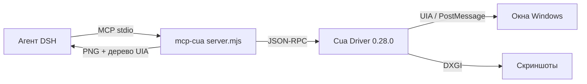

# mcp-cua

**RU** · [English](#english)

## RU

MCP-сервер (stdio) для **DeepSeek Harness**, который отдаёт агенту управление рабочим столом Windows
через драйвер [Cua](https://github.com/trycua/cua) 0.28.0: окна, дерево доступности UIA, скриншоты,
клики, ввод, буфер обмена.

Нужен там, где встроенный computer use недоступен: DSH умеет computer use только на macOS, а на
Windows эта связка даёт те же возможности локально.

### Зачем отдельный процесс

Сервер запускается самостоятельным процессом, а не внутри DSH: нативный драйвер может упасть, и в
этом случае падает только он — `dsh-mcp-client` переподключает сервер, сессия DSH остаётся живой.

### Инструменты

По умолчанию открыт курируемый набор из 26 инструментов — он покрывает «прочитать экран» и «нажать
кнопку», не заваливая модель десятками лишних схем.

| Инструмент | Назначение |
|---|---|
| `list_apps` | запущенные и установленные приложения |
| `list_windows` | окна с границами, z-index, признаком «на экране» |
| `get_window_state` | дерево UIA + скриншот + `snapshot_id` и `element_token` |
| `get_accessibility_tree` | лёгкий обзор рабочего стола без снимка окна |
| `get_desktop_state` | скриншот всего экрана в физических пикселях |
| `get_screen_size` | размер экрана и масштаб |
| `zoom` | увеличение участка окна в нативном разрешении |
| `launch_app` | запуск приложения, в том числе пакетного (AUMID) |
| `bring_to_front` | активация окна (намеренно ломает контракт «без фокуса») |
| `click` / `double_click` / `right_click` | клики по `element_index` или координатам |
| `drag` | перетаскивание с шагами |
| `type_text` / `press_key` / `hotkey` / `set_value` | ввод и сочетания клавиш |
| `scroll` | прокрутка окна |
| `invoke_menu` | пункт меню по точному пути |
| `verify_state` | проверка предикатов по окну |
| `clipboard_read` / `clipboard_write` | буфер обмена |
| `set_window_frame` | точная геометрия окна |
| `kill_app` | принудительное завершение |
| `check_permissions` / `health_report` | диагностика драйвера |

`--all` открывает все 56 инструментов драйвера, `CUA_MCP_TOOLS=a,b,c` задаёт свой список,
`--verbose` пишет протокол в stderr.

### Установка

```bash
# 1) зависимости
cd ~/.dsh/bin/cua-mcp && pnpm install        # @trycua/cua-driver 0.28.0

# 2) регистрация в профиле DSH (~/.dsh/profiles/desktop/cordis.patch.yml)
#    mcp.servers.pc → command: node, args: [server.mjs]
```

В DSH появятся инструменты `mcp__pc__*`.

### Правила работы

1. Сначала `list_windows`, затем `get_window_state` — и только потом действие.
2. Предпочитать `element_index`/`element_token` координатам: они переживают перестройку интерфейса.
3. Доставка по умолчанию — фоновая, без перехвата фокуса; `foreground` только после ошибки
   `background_unavailable`.
4. После каждого действия — новый снимок состояния, а не предположение об успехе.

Подробнее: [документация](../docs/ru/mcp-cua.md) · [схема](#схема-работы)

### Схема работы



## English

Stdio MCP server for **DeepSeek Harness** that gives an agent control of the Windows desktop through
the [Cua](https://github.com/trycua/cua) driver 0.28.0: windows, the UIA accessibility tree,
screenshots, clicks, typing and the clipboard.

It exists because DSH provides computer use on macOS only; on Windows this bridge delivers the same
capability locally.

### Why a separate process

The server runs on its own: the native driver can crash, and when it does only that process dies —
`dsh-mcp-client` reconnects it and the DSH session stays alive.

### Tools

By default a curated set of 26 tools is exposed, enough to read the screen and press the buttons
without flooding the model with dozens of extra schemas.

| Tool | Purpose |
|---|---|
| `list_apps` | running and installed applications |
| `list_windows` | windows with bounds, z-index and on-screen flag |
| `get_window_state` | UIA tree + screenshot + `snapshot_id` and `element_token` |
| `get_accessibility_tree` | lightweight desktop overview without a window capture |
| `get_desktop_state` | full-screen capture in physical pixels |
| `get_screen_size` | display size and scale factor |
| `zoom` | enlarge a window region at native resolution |
| `launch_app` | start an app, including packaged ones (AUMID) |
| `bring_to_front` | activate a window (deliberately breaks the no-focus contract) |
| `click` / `double_click` / `right_click` | clicks by `element_index` or coordinates |
| `drag` | press-drag-release with intermediate moves |
| `type_text` / `press_key` / `hotkey` / `set_value` | typing and key combinations |
| `scroll` | window scrolling |
| `invoke_menu` | a menu item by exact path |
| `verify_state` | predicate checks against a window |
| `clipboard_read` / `clipboard_write` | clipboard access |
| `set_window_frame` | exact window geometry |
| `kill_app` | force termination |
| `check_permissions` / `health_report` | driver diagnostics |

`--all` exposes all 56 driver tools, `CUA_MCP_TOOLS=a,b,c` sets an explicit list, `--verbose` logs the
protocol to stderr.

### Install

```bash
cd ~/.dsh/bin/cua-mcp && pnpm install        # @trycua/cua-driver 0.28.0
# register in ~/.dsh/profiles/desktop/cordis.patch.yml → mcp.servers.pc
```

The tools appear as `mcp__pc__*`.

### Operating rules

1. `list_windows` first, then `get_window_state`, then act.
2. Prefer `element_index`/`element_token` over coordinates: they survive layout rebuilds.
3. Background delivery by default; use `foreground` only after `background_unavailable`.
4. Take a fresh snapshot after every action instead of assuming success.

More: [documentation](../docs/en/mcp-cua.md) · diagram above.

### License

MIT
