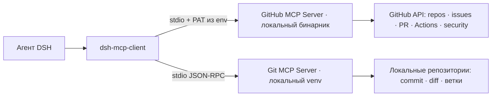
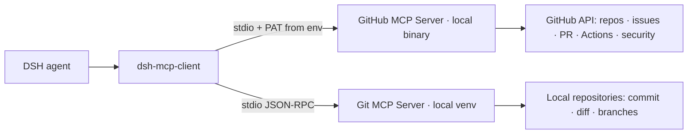

# mcp-github-universal

**RU** · [English](#english)

## RU

Конфигурационный пакет DeepSeek Harness, который подключает к агентам GitHub «под ключ» —
одним локальным официальным сервером GitHub MCP (`$DSH_HOME/bin/github-mcp-server`,
принимает fine-grained PAT). Секретов в пакете нет: токен и список toolsets читаются из
переменных окружения, путь к бинарнику — из dsh-хоума.

С версии 0.3.0 пакет ставит **ровно один** MCP-сервер. Облачный эндпоинт
`api.githubcopilot.com` и копия git-сервера убраны как дубли (см. «Что изменилось»).

### Что появляется у агента

| Инструменты | Источник | Что умеют |
|---|---|---|
| `mcp__github__*` | официальный GitHub MCP Server локально (бинарник v2.2.0 в `$DSH_HOME/bin`) | репозитории и файлы, issues, pull request'ы, Actions/CI, code scanning, gists, уведомления, пользователи — 62 инструмента при текущем наборе toolsets, до 91 при `GITHUB_TOOLSETS=all` |
| `mcp__git__*` | `mcp-server-git` из venv `$DSH_HOME/venvs/mcp-git` | `status`, `diff`, `add`, `commit`, ветки, `checkout`, `merge`, `log`, `show`, `remote` — операции в локальных репозиториях |

Git-сервер объявлен в патче **профиля** (Linux-путь `venvs/mcp-git/bin/python`), а не в этом
пакете: раньше обе копии спорили за id `mcp-git-local`, и пакетная ссылалась на Windows-путь
`Scripts/python.exe`, поэтому на Linux не запускалась и утягивала за собой профильную.

### Что изменилось в 0.3.0

- **убран `mcp__github-cloud__*`** — `api.githubcopilot.com/mcp/x/all` отвечает 403 на любой
  класс токенов на этом хосте и дублировал ~90 имён инструментов локального сервера;
- **убран дубль `git`** — единственное определение осталось в профиле;
- `failOnStartupError: true` у github-части: сервер обязателен, молчаливая деградация без него
  (агент «не видит» GitHub) хуже, чем явная ошибка в журнале;
- починен вызов инструментов: клиент MCP больше не падает на серверах, которые объявляют
  `outputSchema`, но отвечают только текстом (см. «Почему раньше не работало»).

### Настройка toolsets

Набор инструментов задаётся переменной окружения — одна строка, без правки пакета:

```bash
# /etc/dsh/dsh-github.env (systemd EnvironmentFile у службы dsh-web)
GITHUB_TOOLSETS=default,actions,gists,notifications,code_security   # 62 инструмента
# GITHUB_TOOLSETS=all                                               # все 91
# GITHUB_TOOLSETS=repos,issues,pull_requests                        # минимум
```

`default` = `context, copilot, issues, pull_requests, repos, users`. Полный список групп:
`actions, code_quality, code_security, copilot, copilot_automations, copilot_issue_intents,
dependabot, discussions, gists, git, governance, issues, labels, notifications, orgs, projects,
pull_requests, repos, secret_protection, security_advisories, stargazers, users`.

### Быстрый старт 🚀

```bash
# 1) токен: github.com/settings/personal-access-tokens/new
#    Fine-grained PAT; нужно: Contents, Issues, Pull requests — Read and write
#    Metadata — read-only (включается сама), Actions — read; Workflows — read and write (по желанию)
#    Для mcp__github__list_notifications нужен доступ Notifications — read (fine-grained PAT
#    выдаёт «Resource not accessible by integration», пока он не включён)
#    Классический токен: scopes repo + workflow (+ notifications, если нужны уведомления)

# 2) переменные окружения (пример — /etc/dsh/dsh-github.env)
GITHUB_PERSONAL_ACCESS_TOKEN=github_pat_...
GITHUB_TOOLSETS=default,actions,gists,notifications,code_security

# 3) подключение пакета в профиль DeepSeek Harness → install_bundle
```

После этого в DSH появляются инструменты `mcp__github__*` (и `mcp__git__*` из профиля).

### Почему раньше не работало

SDK `@modelcontextprotocol/client` (2.2.0) требует `structuredContent` от любого инструмента,
у которого в `tools/list` объявлен `outputSchema`. GitHub MCP Server объявляет схемы, но
отвечает только текстовыми блоками — и каждый вызов падал с
`Tool get_me has an output schema but did not return structured content`, хотя сам ответ
приходил корректным. Лечение — локальный патч ядра, который переживает обновления DSH:

```bash
/srv/apps/dsh/settings/patches/apply-mcp-lenient-structured.py    # применяется из apply.sh
```

Патч правит оба билда SDK (`dist/index.mjs` и `dist/index.cjs`): при отсутствии
`structuredContent` он синтезируется из первого JSON-текста, а несовпадение со схемой
понижается до «поля нет» вместо ошибки вызова.

### Проверено ✅

- `mcp__github__get_me` возвращает аккаунт владельца токена (`login: rukazax`).
- `mcp__git__git_status` отвечает на реальном репозитории (на не-git каталоге — ожидаемая ошибка).
- `mcp__github__list_branches` / `get_file_contents` работают против `rukazax/deepseek_harness`.
- `mcp__github__list_notifications` отвечает 403, пока у токена нет доступа Notifications — это
  ограничение прав PAT, а не сбоя сервера.

### Правила работы

1. Токен живёт в переменной `GITHUB_PERSONAL_ACCESS_TOKEN` (`/etc/dsh/dsh-github.env` или
   `~/.dsh/.env`) — **никогда в коде и не в git**.
2. `failOnStartupError: true`: без токена сервер поднимется, но GitHub-инструменты будут
   отвечать ошибкой авторизации — по журналу `journalctl -u dsh-web` это видно сразу.
3. Пишущие операции GitHub требуют достаточных прав токена; ответ 403 — сигнал расширить права PAT
   — сохранение через *Update token* меняет доступ без перевыпуска строки.

Подробнее: [документация](../docs/ru/mcp-github-universal.md) · [схема](#схема)

### Схема



---

## English

A configuration package for DeepSeek Harness that wires GitHub out of the box through a single
local official GitHub MCP Server (`$DSH_HOME/bin/github-mcp-server`, fine-grained PAT friendly).
The package keeps no secrets: the token and the toolsets list are read from environment
variables, the binary path comes from the dsh home.

Since 0.3.0 the package installs **exactly one** MCP server. The cloud endpoint
`api.githubcopilot.com` and the duplicate git server are gone (see “What changed”).

### What the agent gets

| Tools | Origin | Capabilities |
|---|---|---|
| `mcp__github__*` | official GitHub MCP Server locally (v2.2.0 binary in `$DSH_HOME/bin`) | repositories and files, issues, pull requests, Actions/CI, code scanning, gists, notifications, users — 62 tools with the current toolset set, up to 91 with `GITHUB_TOOLSETS=all` |
| `mcp__git__*` | `mcp-server-git` from the `$DSH_HOME/venvs/mcp-git` venv | `status`, `diff`, `add`, `commit`, branches, `checkout`, `merge`, `log`, `show`, `remote` — operations in local repositories |

The git server is declared in the **profile** patch (Linux path `venvs/mcp-git/bin/python`), not in
this package: both copies used to fight over the `mcp-git-local` id while the packaged one pointed
at the Windows `Scripts/python.exe` path, so on Linux it never started and took the profile copy
down with it.

### What changed in 0.3.0

- **`mcp__github-cloud__*` removed** — `api.githubcopilot.com/mcp/x/all` answers 403 for every
  token class on this host and duplicated ~90 tool names of the local server;
- **duplicate `git` removed** — the single definition stays in the profile;
- `failOnStartupError: true` on the GitHub part: the server is mandatory, and silent degradation
  (an agent that “cannot see” GitHub) is worse than a loud error in the journal;
- tool calls fixed: the MCP client no longer fails on servers that declare `outputSchema` but answer
  with text only (see “Why it did not work before”).

### Toolsets

The tool set comes from an environment variable — a single line, no package edit:

```bash
# /etc/dsh/dsh-github.env (the dsh-web systemd EnvironmentFile)
GITHUB_TOOLSETS=default,actions,gists,notifications,code_security   # 62 tools
# GITHUB_TOOLSETS=all                                               # all 91
# GITHUB_TOOLSETS=repos,issues,pull_requests                        # minimal
```

`default` = `context, copilot, issues, pull_requests, repos, users`. Full group list:
`actions, code_quality, code_security, copilot, copilot_automations, copilot_issue_intents,
dependabot, discussions, gists, git, governance, issues, labels, notifications, orgs, projects,
pull_requests, repos, secret_protection, security_advisories, stargazers, users`.

### Quick start 🚀

```bash
# 1) the token: github.com/settings/personal-access-tokens/new
#    Fine-grained PAT; required: Contents, Issues, Pull requests — Read and write
#    Metadata — read-only (automatic), Actions — read; Workflows — read and write (optional)
#    mcp__github__list_notifications needs the Notifications — read permission (a fine-grained
#    PAT answers "Resource not accessible by integration" until it is granted)
#    Classic token: repo + workflow scopes (+ notifications if you need them)

# 2) environment variables (example: /etc/dsh/dsh-github.env)
GITHUB_PERSONAL_ACCESS_TOKEN=github_pat_...
GITHUB_TOOLSETS=default,actions,gists,notifications,code_security

# 3) install the package into the DeepSeek Harness profile → install_bundle
```

Afterwards DSH exposes the `mcp__github__*` tools (and `mcp__git__*` from the profile).

### Why it did not work before

`@modelcontextprotocol/client` (2.2.0) requires `structuredContent` from any tool that declares an
`outputSchema` in `tools/list`. The GitHub MCP Server declares the schemas but answers with text
blocks only, so every call failed with
`Tool get_me has an output schema but did not return structured content` even though the payload
was correct. The fix is a local core patch that survives DSH upgrades:

```bash
/srv/apps/dsh/settings/patches/apply-mcp-lenient-structured.py    # applied by apply.sh
```

It patches both SDK builds (`dist/index.mjs` and `dist/index.cjs`): a missing `structuredContent`
is synthesised from the first JSON text block, and a schema mismatch degrades to “no field”
instead of a failed call.

### Verified ✅

- `mcp__github__get_me` returns the token owner's account (`login: rukazax`).
- `mcp__git__git_status` answers for a real repository (on a non-git directory — the expected error).
- `mcp__github__list_branches` / `get_file_contents` work against `rukazax/deepseek_harness`.
- `mcp__github__list_notifications` answers 403 until the PAT gets Notifications access — a token
  permission limit, not a server failure.

### Working rules

1. The token lives in `GITHUB_PERSONAL_ACCESS_TOKEN` (`/etc/dsh/dsh-github.env` or `~/.dsh/.env`) —
   **never in code and never in git**.
2. `failOnStartupError: true`: without a token the server still starts, but GitHub tools answer with
   an authorization error — `journalctl -u dsh-web` shows it immediately.
3. GitHub write operations require sufficient token scopes; a 403 response means the PAT needs
   broader permissions — saving via *Update token* changes access without re-issuing the string.

More: [documentation](../docs/en/mcp-github-universal.md) · [diagram](#diagram)

### Diagram


