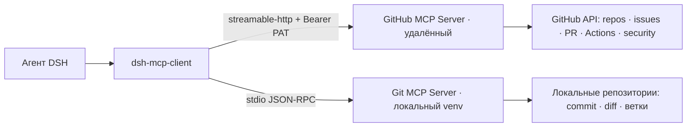
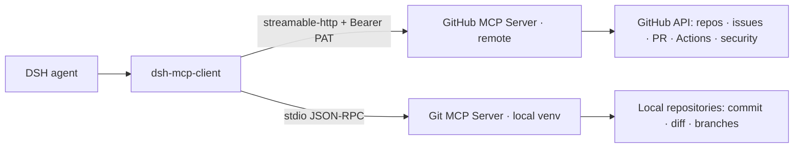

# mcp-github-universal

**RU** · [English](#english)

## RU

Конфигурационный пакет DeepSeek Harness, который подключает к агентам сразу два MCP-сервера и
делает GitHub доступным «под ключ». Облачная часть — официальный удалённый сервер GitHub MCP
(набор toolsets `all`), локальная — Git-сервер для работы с репозиториями этого компьютера.
Секретов в пакете нет: токен читается из переменной окружения, путь к Python — из dsh-хоума.

### Что появляется у агента

| Инструменты | Источник | Что умеют |
|---|---|---|
| `mcp__github__*` | официальный удалённый GitHub MCP Server | репозитории и файлы, issues, pull request'ы, Actions/CI, code scanning, gists, обсуждения, проекты, пользователи и организации |
| `mcp__git__*` | локальный `mcp-server-git` из venv `~/.dsh/venvs/mcp-git` | `status`, `diff`, `add`, `commit`, ветки, `checkout`, `merge`, `log`, `show`, `remote` — операции в локальных репозиториях |

Связка живёт без присмотра: потерю связи сервер пересоединяется сам (0,5 → 30 с, до 10 попыток),
а при обновлении списка инструментов просто заменяет старый набор новым.

### Быстрый старт 🚀

```bash
# 1) локальный Git-сервер (один раз)
python -m venv ~/.dsh/venvs/mcp-git
~/.dsh/venvs/mcp-git/Scripts/python -m pip install mcp-server-git      # Windows
#   Linux:  ~/.dsh/venvs/mcp-git/bin/python -m pip install mcp-server-git

# 2) токен: github.com/settings/personal-access-tokens/new
#    Fine-grained PAT; нужно: Contents, Issues, Pull requests — Read and write
#    Metadata — read-only (включается сама), Actions — read; Workflows — read and write (по желанию)
#    Классический токен: scopes repo + workflow

# 3) переменная окружения
#    Строка GITHUB_PERSONAL_ACCESS_TOKEN=github_pat_... в ~/.dsh/.env и перезапуск DSH
#    (локальные установки также читают токен из патча профиля — см. docs)

# 4) подключение пакета в профиль DeepSeek Harness → install_bundle
```

После этого в DSH появляются инструменты `mcp__github__*` и `mcp__git__*`.

### Проверено ✅

- `mcp__github__get_me` возвращает аккаунт владельца токена.
- `mcp__git__git_status` отвечает на реальном репозитории (на не-git каталоге — ожидаемая ошибка).

### Правила работы

1. Токен живёт в переменной `GITHUB_PERSONAL_ACCESS_TOKEN` (строка `~/.dsh/.env`) или в патче
   локального профиля — **никогда в коде и не в git**.
2. `failOnStartupError: false` у github-части: без токена DSH стартует спокойно, инструменты
   просто не появляются до появления токена.
3. Пишущие операции GitHub требуют достаточных прав токена; ответ 403 — сигнал расширить права PAT
   — сохранение через *Update token* меняет доступ без перевыпуска строки.

Подробнее: [документация](../docs/ru/mcp-github-universal.md) · [схема](#схема)

### Схема



---

## English

A configuration package for DeepSeek Harness that wires two MCP servers to the agents and makes
GitHub available out of the box. The cloud part is the official remote GitHub MCP Server (the `all`
toolsets); the local part is a Git server for operations in repositories on this machine. The package
keeps no secrets: the token is read from an environment variable, the Python path comes from the
dsh home.

### What the agent gets

| Tools | Origin | Capabilities |
|---|---|---|
| `mcp__github__*` | official remote GitHub MCP Server | repositories and files, issues, pull requests, Actions/CI, code scanning, gists, discussions, projects, users and organizations |
| `mcp__git__*` | local `mcp-server-git` from the `~/.dsh/venvs/mcp-git` venv | `status`, `diff`, `add`, `commit`, branches, `checkout`, `merge`, `log`, `show`, `remote` — operations in local repositories |

The setup runs unattended: a lost connection is re-established automatically
(0.5 → 30 s, up to 10 attempts), and a changed tool list simply replaces the old set.

### Quick start 🚀

```bash
# 1) the local Git server (once)
python -m venv ~/.dsh/venvs/mcp-git
~/.dsh/venvs/mcp-git/Scripts/python -m pip install mcp-server-git      # Windows
#   Linux:  ~/.dsh/venvs/mcp-git/bin/python -m pip install mcp-server-git

# 2) the token: github.com/settings/personal-access-tokens/new
#    Fine-grained PAT; required: Contents, Issues, Pull requests — Read and write
#    Metadata — read-only (automatic), Actions — read; Workflows — read and write (optional)
#    Classic token: repo + workflow scopes

# 3) the environment variable
#    Add GITHUB_PERSONAL_ACCESS_TOKEN=github_pat_... to ~/.dsh/.env and restart DSH
#    (local installs may also read the token from the profile patch — see docs)

# 4) install the package into the DeepSeek Harness profile → install_bundle
```

Afterwards DSH exposes the `mcp__github__*` and `mcp__git__*` tools.

### Verified ✅

- `mcp__github__get_me` returns the token owner's account.
- `mcp__git__git_status` answers for a real repository (on a non-git directory — the expected error).

### Working rules

1. The token lives in the `GITHUB_PERSONAL_ACCESS_TOKEN` variable (a `~/.dsh/.env` line) or in the
   local profile patch — **never in code and never in git**.
2. `failOnStartupError: false` on the GitHub part: without a token DSH starts calmly; the tools
   simply do not appear until the token exists.
3. GitHub write operations require sufficient token scopes; a 403 response means the PAT needs
   broader permissions — saving via *Update token* changes access without re-issuing the string.

More: [documentation](../docs/en/mcp-github-universal.md) · [diagram](#diagram)

### Diagram


