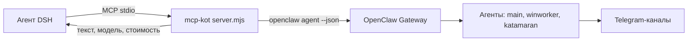

# mcp-kot

**RU** · [English](#english)

## RU

MCP-сервер (stdio), который соединяет чат DeepSeek Harness с агентом **Kot** в OpenClaw: один
инструмент передаёт запрос и возвращает ответ, остальные показывают состояние Gateway, каналов,
агентов, сессий и рабочих пространств.

Так удобно разделять роли: DSH занимается файлами и командами, Kot — координацией и приёмкой, а
пользователь в любом чате может позвать второго агента и получить его ответ дословно.

### Инструменты

| Инструмент | Назначение |
|---|---|
| `kot_ask` | один ход агента: `prompt` + `workspace`, `session_key`, `agent`, `thinking`, `timeout_seconds`; возвращает текст, модель и стоимость |
| `kot_status` | версия Gateway, pid, число сессий, агенты, состояние каналов |
| `kot_channels` | Telegram-аккаунты: running/connected, режим, ошибки |
| `kot_agents` | агенты OpenClaw с рабочими каталогами и моделями |
| `kot_sessions` | последние сессии/чаты (агент, ключ, статус, время) |
| `kot_workspaces` | карта рабочих пространств DSH (путь, название, число чатов) |

### Как это устроено

`kot_ask` не изобретает протокол: он вызывает CLI OpenClaw (`openclaw agent --agent main --json`) и
разбирает ответ. Один `session_key` — одна непрерывная беседа, поэтому у каждого рабочего
пространства DSH своя линия с Kot (`dsh-<имя папки>`).

Важное следствие: длинную задачу нельзя «провернуть» одним вызовом. Правильный режим — короткие
поручения и короткие опросы статуса; задача остаётся в сессии Kot и не теряется между вызовами.

### Требования

- запущенный Gateway OpenClaw (по умолчанию `127.0.0.1:18789`);
- установленный CLI `openclaw` в PATH;
- агент, к которому идёт обращение (`main`, `winworker`, `katamaran`, …).

### Установка

```bash
# профиль DSH: mcp.servers.kot → command: node, args: [server.mjs]
```

В DSH появятся инструменты `mcp__kot__*`.

Подробнее: [документация](../docs/ru/mcp-kot.md) · [схема](#схема-работы)

### Схема работы



## English

A stdio MCP server that connects a DeepSeek Harness chat to the **Kot** agent in OpenClaw: one tool
sends a prompt and returns the answer, the rest expose Gateway, channel, agent, session and workspace
state.

It is useful for splitting roles: DSH handles files and commands, Kot coordinates and reviews, and a
user in any chat can call the second agent and get its answer verbatim.

### Tools

| Tool | Purpose |
|---|---|
| `kot_ask` | one agent turn: `prompt` plus `workspace`, `session_key`, `agent`, `thinking`, `timeout_seconds`; returns text, model and cost |
| `kot_status` | Gateway version, pid, session count, agents, channel state |
| `kot_channels` | Telegram accounts: running/connected, mode, errors |
| `kot_agents` | OpenClaw agents with working directories and models |
| `kot_sessions` | recent sessions/chats (agent, key, status, time) |
| `kot_workspaces` | DSH workspace map (path, name, chat count) |

### How it works

`kot_ask` does not invent a protocol: it shells out to the OpenClaw CLI (`openclaw agent --agent main
--json`) and parses the result. One `session_key` is one continuous conversation, so each DSH
workspace gets its own line to Kot (`dsh-<folder name>`).

A consequence worth stating: a long task cannot be finished inside a single call. The working mode is
short assignments plus short status polls; the task stays in Kot's session between calls.

### Requirements

- a running OpenClaw Gateway (default `127.0.0.1:18789`);
- the `openclaw` CLI in PATH;
- the target agent (`main`, `winworker`, `katamaran`, …).

### Install

```bash
# DSH profile: mcp.servers.kot → command: node, args: [server.mjs]
```

The tools appear as `mcp__kot__*`.

More: [documentation](../docs/en/mcp-kot.md) · diagram above.

### License

MIT
